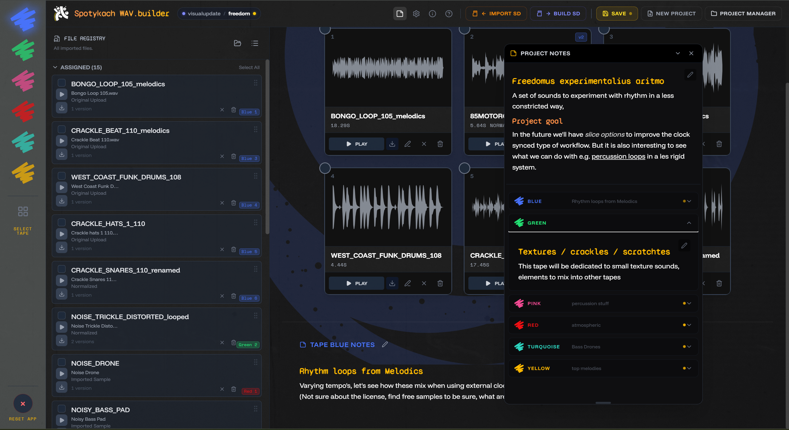
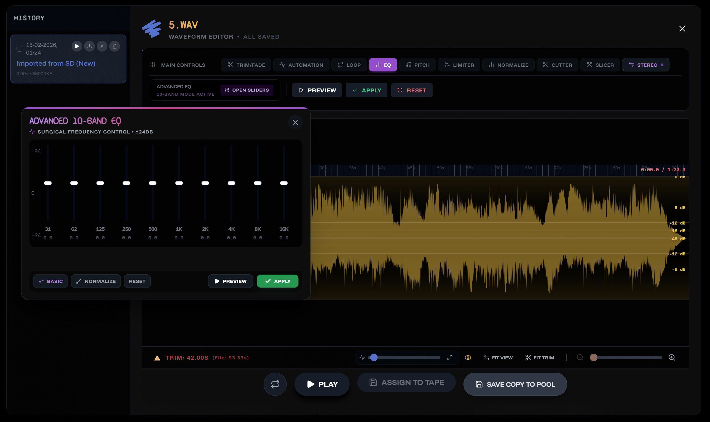
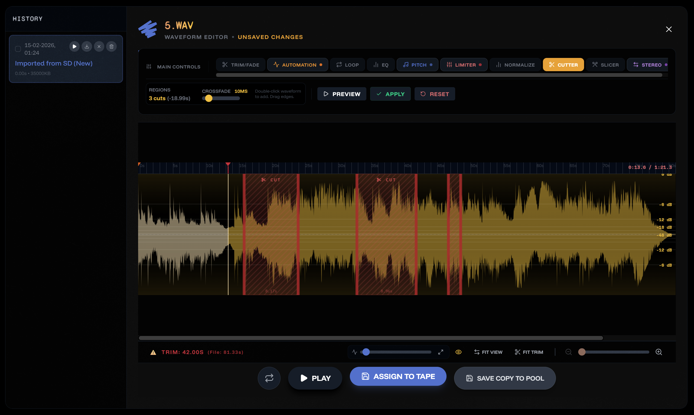

# Spotykach WAV Builder

[](https://jonwaterschoot.github.io/spotykach_WAV_builder/)

> **Desktop Chrome or Edge recommended.** Browse Samples works on a phone; the other parts open folders on your drive or lay out grids and waveforms a phone screen can't hold.

A specialized tool for preparing audio files for the **Synthux Spotykach Looper playground**. It streamlines the process of converting, trimming, and organizing samples and projects to meet the strict firmware requirements (48 kHz stereo, 32-bit float WAV).



Core concept: allow to either import audio files recorded with Spotykach or make a collection of audio files and upload those to the SD card.

Spotykach has 6 tapes, each tape has 6 slots. Each slot can hold a mono or stereo sample. (only the first 42 seconds of each sample are used)

## Where to start

The app opens on a hub, grouped by what you came to do:

-   **Get sounds onto your Spotykach**
    -   **Browse Samples**: listen through the sample packs, collect what you like, and download it as a ready card (6×6) or as loose files. No setup; works on a phone.
    -   **Preset to SD Card**: a ready-made card from a curated set, written straight to your SD card.
-   **Make your own set**
    -   **Studio**: the full workspace. Projects of 6 tapes × 6 slots with notes, the waveform editor, and building and syncing the card. Needs a work folder on your drive.
    -   **Edit One File**: Studio's editor for a single file, no project needed.
-   **Tools & extras**
    -   **Device Config**: edit the Spotykach's `config.txt` (MIDI channels, preloading, transport, slice mode).
    -   **Sample Mangler**: random snippets from the packs or your own files, joined into one 42 s file.
-   **Submit a pack**: turn your own sounds into a sample pack or preset for this app.

## Features

-   **SD card build and sync**: build the `SK/` folder straight onto the card (File System Access API, Chrome/Edge), or import a card into a project. The preview shows every slot's fate before anything is written, and recognises what the project wrote before.
-   **USB transfer (beta)**: with the [1.4.0 beta firmware](https://github.com/Synthux-Academy/Spotykach/releases/tag/v.1.4.0.b1), reach the card while it stays in the Spotykach, through its rear USB port. Turn it on in Settings ▸ System. The card reader is faster (about 35 s per full slot over USB); connect directly to a USB-A port, not through a hub.
-   **Audio Processing**: drag and drop any audio format, with automatic conversion to 48 kHz stereo 32-bit float WAV.
-   **Tape-Based Organization**: 6 color-coded tapes with 6 slots each, mirroring the hardware, with notes per tape and per project in `project.json`.
-   **Device settings**: `config.txt` is kept in the project and written to the card with it.




-   **Waveform Editor**: 
    -   The editor uses a destructive workflow, yet a history of each iteration is kept in the project and shown per file in the editor's history panel. This allows you to go back to any previous iteration of the file.

    -   **Main Controls**: Global playback, waveform display, and file management.
    -   **Trim / Fade**: Set start/end trim points and apply fade-in/fade-out curves. **Hardware Constraints**: Visual indicators for the strictly enforced 42-second hardware buffer limit.
    -   **Automation**: Draw volume automation envelopes over time (ramps, dips, custom shapes).
    -   **Loop**: Define loop regions with configurable crossfading for seamless, gapless loops.
    -   **EQ**: 3-band, or 10-band equalizer for tonal shaping of the audio.
    -   **Pitch**: Pitch-shift the sample or multiple parts of the sample.
    -   **Limiter**: Ceiling limiter to prevent clipping and control peak output level.
    -   **Normalize**: Boost or lower the file's peak or RMS level to a target value.
    -   **Cutter**: Cut out unwanted sections and merge remaining pieces with a crossfade.
    -   **Slicer**: Up to 255 slices with keyboard/MIDI auditioning. They reach the card as cue points, which the Spotykach's slice mode plays.
    -   **Stereo**: split stereo files into two mono files with visual feedback of the two channels.
    -   **Mangler**: a new take from random snippets of the open file, with a cue point at each snippet.
-   **Sample Browser**:
    -   **Curated Packs**: Browse and import community-contributed sample packs.
    -   **Open archives**: search Openverse, Wikimedia Commons, the Internet Archive, NASA and Freesound, filtered by licence; each sound keeps its author and licence.
    -   **Library Management**: Build a persistent user library and pull samples from other local projects.
-   **Sample Mangler**: random snippets from a pool of sources joined into one file of up to 42 s, with seeds, pitch detection and licences that follow the snippets used.
-   **Project Portability**: Save and restore work states via Project JSON or create full backups to local storage and SD cards.



## Technology Stack

This project is built using:

-   **[React](https://react.dev/)**: UI Framework.
-   **[Vite](https://vitejs.dev/)**: Build tool and dev server.
-   **[Tailwind CSS](https://tailwindcss.com/)**: Styling.
-   **[WaveSurfer.js](https://wavesurfer.xyz/)**: Audio visualization and manipulation.
-   **[@synthuxacademy/spotykach-transfer](https://github.com/Synthux-Academy/Spotykach/tree/uploader/web/spotykach-transfer)**: Synthux's own package. It writes every slot file (the same encoder as the firmware's uploader page) and runs USB transfer.
-   **[ffmpeg.wasm](https://ffmpegwasm.netlify.app/)**: Converting audio formats the browser can't decode, served from this origin.
-   Written with LLM assistance: set up in Google Antigravity, continued with Claude Code.

## Getting Started

1.  **Clone the repository**
    ```bash
    git clone https://github.com/jonwaterschoot/spotykach_WAV_builder.git
    cd spotykach_WAV_builder
    ```

2.  **Install Dependencies**
    ```bash
    npm install
    ```

3.  **Run Development Server**
    ```bash
    npm run dev
    ```

4.  **Build**
    ```bash
    npm run build
    ```

5.  **Checks** (no browser needed)
    ```bash
    npm run check:wav      # WAV headers against ports of both firmwares' parsers
    npm run check:slots    # slot files from the transfer package
    npm run check:card     # export and sync end to end, card reader and USB
    npm run check:mangler
    npm run check:online
    ```

## Live Demo

Check out the live version here: [https://jonwaterschoot.github.io/spotykach_WAV_builder/](https://jonwaterschoot.github.io/spotykach_WAV_builder/)

## Privacy

The app runs entirely in your browser. Audio, projects and settings live in IndexedDB and — if
you grant access — in folders you pick yourself through the File System Access API. Nothing is
uploaded, and there is no analytics or telemetry of any kind.

Rendering the page contacts no third party: **fonts are self-hosted** from
[`public/fonts/`](public/fonts/) under the SIL Open Font License 1.1, and the ffmpeg core is
served from this origin rather than a CDN. The app makes outbound requests on your behalf only
when you ask for something:

-   downloading sample and preset packs, from Cloudflare R2;
-   searching open archives: Openverse, Wikimedia Commons, the Internet Archive and NASA directly,
    and Freesound through a small Cloudflare Worker that holds a shared key (or directly, with
    your own key).

USB transfer talks only to the Spotykach on your desk, through the browser's serial port access.

## Publishing (maintainers)

The live site is published **manually, from a maintainer's machine**. There is no Actions
workflow, so **pushing to `main` does not update the site** — main can be ahead of what is live.

```bash
npm run deploy        # builds, then pushes dist/ to the gh-pages branch
```

Commit first: the deploy ships the working tree, not `main`. It takes about half a minute end to
end, so small changes — one new screenshot in a news article — are deployed the same way as a
release. On Windows, use `npm.cmd run deploy` if PowerShell blocks the script.

Full detail in [docs/deployment_guidelines.md](docs/deployment_guidelines.md).


## Roadmap

### Priority Features

- **Onboarding**: Improved first-run flow explaining projects and tapes before entering the app.
- **Editor UX**: Clearer destructive-workflow messaging, "Done" close button, improved history panel.
- **History & Trashcan** *(under consideration)*: Temporary trashcan for deleted files; Undo/Redo for editor actions.
- **Right-Click Context Menu**: Quick actions (Edit, Move, Delete, Show in browser) on sample cards.
- **SD Card: Prepare empty project**: Erase/format SD card with warnings and content comparison.
- **Sync User Library**: Sync personal sample library to SD card *(almost done — needs final testing)*.
- **Offline Sample Packs**: Download GitHub sample packs for offline use.

### Long Term

- **Desktop App**: Electron/PWA wrapper for native dialogs and offline use.
- **Cloud Sync**: Google Drive/Dropbox integration?
- **Mobile Optimization**: Improved layout for tablets/phones *(not a priority)*.

## Documentation & Guides

Whether you are a musician contributing a sample pack, a user sharing a project layout, or a developer/maintainer working on the app, check out the relevant guides below:

*   **For Musicians & Preset Creators**:
    *   [Sample & Preset Submission Guide](docs/presets-samples/README.md) – What to know before opening the app's submission tool, which collects and checks the rest for you.
*   **For Developers & Maintainers**:
    *   [Preset Upload & Integration Guide](public/presets/README.md) – Developer instructions on integrating presets, JSON schema specs, and deploying sample packs.
    *   [Audio Processing & Normalization Scripts](scripts/normalize-audio.md) – Documentation for running scripts to normalize, FLAC-compress, and tag audio files.
    *   [Documentation Index](docs/README.md) – Every documentation file in the repository, what it covers, and whether it is still current.

## Contributing

We welcome contributions!
-   **Found a bug?** Open an issue on [GitHub](https://github.com/jonwaterschoot/spotykach_WAV_builder/issues).
-   **Have an idea?** Discuss it with us on the **Synthux Academy Discord**.
-   **Want to build locally?** Check out our [Contribution Guide](CONTRIBUTING.md).

## License

**DO WHAT THE FUCK YOU WANT TO PUBLIC LICENSE**
Version 2, December 2004

Copyright (C) 2026 @jonwaterschoot

Everyone is permitted to copy and distribute verbatim or modified copies of this license document, and changing it is allowed as long as the name is changed.

DO WHAT THE FUCK YOU WANT TO PUBLIC LICENSE
TERMS AND CONDITIONS FOR COPYING, DISTRIBUTION AND MODIFICATION

0. You just DO WHAT THE FUCK YOU WANT TO.
