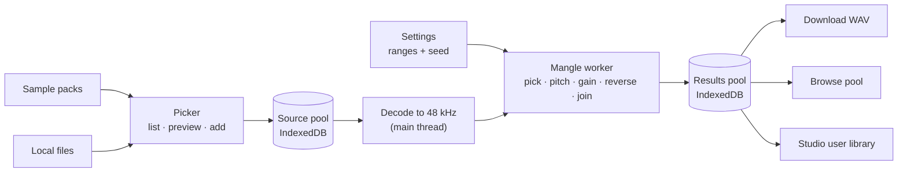

# WAV Builder — Sample Mangler plan

Oct 11, 2026 · Jon · based on WAV Builder 4.1.3 and the idea note in `sample_mangler.md`

## Summary

Sample Mangler is a new hub door. It takes sounds from the sample packs or from your own files, cuts random snippets out of them, and joins those snippets into one file of up to 42 s for Spotykach (or any other sampler). The aim is material that is unpredictable on purpose: every snippet has its own length, loudness, direction and possibly pitch, and a cue point marks where each one starts.

- **One door, no project.** Like Browse and Edit One File, the mangler runs without a work folder. Its source pool and its results live in IndexedDB. It touches the drive or Studio only when you save.
- **Sliders set ranges, the dice pick values.** Each setting is a min/max range or a probability. A seeded random generator picks values inside those ranges, so any result can be generated again from its seed.
- **Batches, not single shots.** One click renders several variations (4 by default) from the same settings with different seeds. You listen, keep the good ones and discard the rest. Kept results stay in a temporary results pool until you save them.
- **Most of the DSP already exists.** Trim, normalize, crossfade, pitch shift by resampling, pitch detection, the 48 kHz float WAV encoder with cue points, the sample browser and the Browse pool are all there. The new work is the snippet engine, a better pitch detector, the batch UI and the save routes.
- **Three ways out:** download the WAV, add it to the Browse pool (which can already build an SK folder), or save it to the Studio user library.

## What already exists

| Need | Existing code | Reuse as is? |
| --- | --- | --- |
| Hub door and route | `src/shell/HubScreen.tsx` (`DOORS`), `src/shell/useAppMode.ts` (`AppMode`, `MODES`), `src/shell/ModeRouter.tsx` | Add a `mangle` mode, same pattern as `submit` |
| Picking samples from packs | `SampleBrowser` with `mode="standalone"` (as hosted in `BrowseMode.tsx`) | Yes, with a slimmer variant (see File picker) |
| Picking local files | `onImportToPool` in `SampleBrowser`, `LocalFolderBrowser`, the file input in `EditorMode` | Yes |
| Decode to 48 kHz | `audioEngine.loadAndProcessAudio` (`src/lib/audio/audioEngine.ts`) | Yes |
| Trim, fades, crossfade loop | `audioProcessor.trim`, `applyFades`, `applyCrossfadeLoop` | Logic yes; reimplemented on raw `Float32Array`s for the worker |
| Normalize | `audioProcessor.normalize` (peak only) | No: loudness matching needs RMS (see Engine) |
| Pitch detection | `audioProcessor.detectPitch` (AMDF over 2048 samples, 50–1000 Hz, channel 0) | No: too crude per snippet. Replace with YIN; the old one stays for the editor |
| Pitch shift | `audioProcessor.applyPitchShift` (resampling, changes length) | Same idea, done in the worker |
| WAV with cue points | `encodeWAV` / `audioProcessor.toWav` with `metadata.slicePoints` | Yes. Cue points at snippet starts come for free |
| Temporary pool | `BrowsePoolEntry`, `saveBrowsePoolToDB` (`src/utils/persistence.ts`) | Yes as a save route; the mangler gets its own stores |
| Studio user library | `UserLibrary` in `src/types.ts`, `saveUserLibraryToDB` / `loadUserLibraryFromDB`; Studio mirrors it to `User_Library/` in the work folder | Yes, through IndexedDB (see Saving) |
| Player | `AudioPlayerContext`, the `hostPlayback` prop on `SampleBrowser` | Yes |

## User flow

1. **Hub → Sample Mangler.** The screen opens on the last session: the source pool and kept results are still there.
2. **Fill the source pool.** Left column: the sample browser in picker mode (packs and local files). Each row has preview and "Add to mangle pool", nothing else. Dropping files on the window also adds them. The pool lists each source with its length and a switch to leave it out of the next batch.
3. **Set the ranges.** Middle column: sliders (see Parameters). A preset menu offers a few starting points (e.g. *Glitch*, *Texture*, *Phrases*).
4. **Generate.** "Generate 4" (count adjustable, 1–12). The variations render in a worker and appear as they finish, each with a waveform, the snippet boundaries, the seed, play, keep and discard.
5. **Refine.** Any variation can be opened to see its snippets: source, length, gain, direction, detected note and pitch shift. "Reroll with these settings" makes a new batch; "Same seed" re-renders one variation after a slider change, so you hear only the effect of that change.
6. **Save.** Per kept result: download WAV, add to Browse pool, or save to the Studio library. Kept results that are never saved stay in the results pool until cleared.



## Parameters

Every range is a two-handle slider. Every value inside it is picked per snippet with the seeded generator.

| Setting | Control | Range | Default | Notes |
| --- | --- | --- | --- | --- |
| Output length | Slider | 1–42 s | 42 s | The hardware plays the first 42 s; never longer |
| Snippet length | Range, log scale | 20 ms – 10 s | 150 ms – 2 s | Picked log-uniformly, so short snippets aren't drowned out by long ones |
| Bias | Slider | short ↔ long | middle | Skews the pick inside the length range |
| Crossfade | Range | 0–3000 ms | 5–40 ms | Equal-power. Clamped to half the shorter of the two snippets |
| Hard cuts | Toggle | — | off | With crossfade 0: off adds a 2 ms declick fade, on leaves the click in |
| Reverse probability | Slider | 0–100 % | 25 % | Per snippet |
| Loudness target | Slider | −30 to −6 dBFS RMS | −18 | All snippets are matched to this (see Engine) |
| Loudness spread | Slider | 0–12 dB | 0 | Random deviation from the target, for dynamics on purpose |
| Max boost | Slider | 0–36 dB | 24 dB | Stops near-silent snippets from being pulled up into hiss |
| Skip silence | Toggle + threshold | −70 to −30 dBFS | on, −50 | Rerolls a snippet whose RMS is below the threshold |
| Repitch to C | Off / Suggest / Apply | — | Suggest | See Pitch |
| Pitch confidence | Slider | 0–1 | 0.8 | Below it, a snippet is left at its own pitch |
| Random detune | Range | ±0–12 semitones | 0 | Extra random shift, after or instead of C |
| Source mix | Even / By length | — | Even | Even: each source is equally likely. By length: longer files are picked more |
| Max per source | Slider | 1–∞ | ∞ | Caps how many snippets one file can give |
| Cue points | Toggle | — | on | One cue point at each snippet start, so SK's slice mode jumps between snippets |
| Loop the file | Toggle | — | off | Crossfades the end into the start, so the 42 s loops cleanly |
| Variations | Slider | 1–12 | 4 | Per click |
| Seed | Number + dice | — | random | Shown per result; typing one in reproduces it |

## Engine

The engine is a pure function: `render(sources, settings, seed) → { left, right, cuePoints, snippets }`. It runs in a Web Worker on `Float32Array`s. `OfflineAudioContext` isn't available in workers, so all DSP here is plain array math. Decoding stays on the main thread with `decodeAudioData` and the channel data is transferred to the worker once per batch.

**1. Plan the snippets (seeded).** Use a small seeded PRNG (mulberry32) so the same seed and settings always give the same file. The plan runs before any audio is touched:

```
remaining = outputLength
while remaining > 0:
    source  = pick(sources, mix, maxPerSource)
    length  = logUniform(minLen, maxLen, bias)
    xfade   = uniform(minXfade, maxXfade), clamped to min(length, prevLength) / 2
    reverse = rand() < reverseProbability
    start   = uniform(0, source.length - length × pitchRatio)
    remaining -= length - xfade
last snippet is trimmed so the total is exactly outputLength
```

The source read length is `length × pitchRatio`, so a snippet keeps its planned length after repitching. The ratio is only known after pitch detection, so the plan is fixed in two passes: pick the start, detect pitch on that region, then widen the region to the needed length. A source shorter than a snippet is used whole.

**2. Per snippet.**

- Cut the region from the source.
- Pitch: detect on the region (see Pitch), compute the shift, resample with linear (later: windowed sinc) interpolation.
- Reverse if picked.
- Loudness: measure gated RMS over 50 ms blocks, skipping blocks below −60 dBFS. Gain = target − measured + random spread, capped at max boost. If the snippet is below the skip-silence threshold, reroll it (max 5 tries, then accept).
- 2 ms fades at both ends when hard cuts is off, so a crossfade of 0 never clicks unless you ask for it.

**3. Join.** Overlap each snippet with the previous one by its crossfade, using equal-power curves (`cos`/`sin`), which hold loudness steady better than the linear fade in `crossfade_technique.md`. Record each snippet's start (the middle of its crossfade) as a cue point.

**4. Finish.** Optional loop crossfade (end into start, same method as `applyCrossfadeLoop`). Then a peak safety pass: if the peak is above −1 dBFS, apply a simple look-ahead limiter, or scale the whole file down when "no limiter" is chosen. Stereo always: mono sources are copied to both channels, as `encodeWAV` already does.

**5. Encode.** Back on the main thread: `encodeWAV(buffer, { slicePoints, processing: ['mangled'] })`. Store the recipe (seed, settings, source ids, snippet list) next to the result in IndexedDB, not in the WAV, so the `ICMT` format stays as it is.

## Pitch

The current `detectPitch` compares 2048 samples of channel 0 against themselves. It has no octave check and no real confidence, which is fine for a hint in the editor but too unreliable to retune snippets automatically.

- **Detector:** YIN (cumulative mean normalized difference), on a mono mix, 2048-sample frames with 50 % overlap, 40 Hz – 2 kHz. Per frame: frequency and aperiodicity.
- **Per snippet:** the median frequency of the voiced frames (aperiodicity < 0.15). Confidence = share of voiced frames × (1 − median aperiodicity). Snippets under 80 ms get no pitch: too few periods for a usable estimate.
- **Shift to C:** the distance in semitones from the detected note to the nearest C, between −6 and +5, so no snippet moves more than half an octave. Cents are kept, so the result really lands on C and not just on "the C key".
- **Modes:** *Off*; *Suggest* (the snippet list shows "D#3 → C, −3 st" and you can apply it per snippet or to all and re-render); *Apply* (shift every snippet above the confidence threshold).
- **Expect misses.** Noise, drums and chords have no single pitch. The confidence threshold is what keeps them unshifted, and the UI shows "no pitch" rather than a guess.

The YIN detector goes in `src/lib/audio/pitch.ts` so the editor's pitch overlay can switch to it later.

## File picker

`SampleBrowser` is 1860 lines and already has a `mode` prop (`'project' | 'standalone'`). Add a third value, `'picker'`, that shows the pack list, the sample list, search, preview and one action button, and hides the rest: preset links, the edit pen, bulk menus, drag to slots, the action menu and library management. The button text comes from a prop (`actionLabel="Add to mangle pool"`), and `onImport` / `onImportToPool` / `onRemoteBulkImport` all go to the mangle pool, the same way `BrowseMode` routes them to its pool.

If the conditionals for a third mode make `SampleBrowser` hard to read, pull the list, the preview and the pack sidebar into smaller components first. That is a separate refactor: do it only if it's needed.

## Storage

Two new IndexedDB stores in `persistence.ts`, with the DB version bumped:

| Store | Key | Holds | Notes |
| --- | --- | --- | --- |
| `mangle-sources` | entry id | name, origin, license, source path, original blob, duration | Like `BrowsePoolEntry` but one blob. Origin and license travel on to the result |
| `mangle-results` | result id | WAV blob, recipe (seed, settings, snippet list), kept flag, created time | The temporary results pool. Unkept results from a batch are dropped when the next batch starts |

Settings and the last seed go in `localStorage` (per-viewer convenience, like the pool's fold state).

**Memory.** Decoded audio is 384 KB per second of stereo 48 kHz float. 10 minutes of sources is about 230 MB and 12 results are another 190 MB. So:

- decode sources on demand per batch and drop them afterwards, with a small cache of the last few;
- cap the active pool at about 10 minutes in total and warn above it;
- store results as encoded WAV blobs (IndexedDB holds them on disk, not in memory) and decode only the one being played.

## Saving

| Route | How | Needs |
| --- | --- | --- |
| Download WAV | `encodeWAV` blob, file name `mangle_<yyyymmdd>_<seed>.wav` | Nothing |
| Browse pool | Append a `BrowsePoolEntry` (original = current = the result) with `loadBrowsePoolFromDB` / `saveBrowsePoolToDB`, same as `EditorMode.addToPool`. Then offer "Open Browse" | Nothing. Browse can already build an SK folder from its pool |
| Studio user library | Load the `UserLibrary` from IndexedDB, add a `FileRecord` (one version, `origin: 'Sample Mangler'`, tag `mangled`, unique `name`), save it back. Studio reads that store when it mounts and copies the file into `User_Library/` on its next autosave | Nothing at save time. A work folder only when Studio opens |

**Why the library route goes through IndexedDB and not straight into `User_Library/`:** Studio's autosave (`saveUserLibraryToDirectory`) deletes any file in that folder that isn't in its library state. A file dropped there without a `FileRecord` might survive only because of the bootstrap scan, depending on timing. Going through the store is the path Studio already trusts, and it needs no folder permission in the mangler.

## Licenses

Decided Oct 11: a source that forbids derivatives blocks saving. Most pack licenses allow using the samples in your own music but not passing the samples on (`music-no-resale`, the NC licenses). A mangled file is still made of those samples, so it may be kept and used, but not shared as a sample.

Pack licenses are stored as free text (`SamplePack.license`, written from `LICENSE_CHOICES` in `src/submission/licenses.ts` or typed as custom terms). Add a small `classifyLicense(text)` next to that list that sorts each source into one of three levels:

| Level | Matches | In the mangler |
| --- | --- | --- |
| **Open** | CC0, CC-BY, CC-BY-SA | No limits. The result's license lists every source that needs attribution (and SA carries over) |
| **Personal use** | `music-no-resale`, CC-BY-NC, and anything that says "not to be redistributed" or "no resale" | Can be saved to all three routes. The result is marked *personal use, do not redistribute*, and Submit a Pack refuses it |
| **No derivatives** | CC-BY-ND, CC-BY-NC-ND, and text that says "no derivatives" or "no modification" | The source can be added and previewed, but any result that uses it cannot be saved. The pool row says why, and the source can be switched off for the next batch |

- **Unknown or custom text** counts as *personal use*, the cautious level that still allows the sound. Show the text on the source row so the user can judge it.
- **Local files** have no license. They count as *open* (they are the user's own), with origin "Local file".
- **The rule follows the snippets actually used, not the whole pool.** A batch from a pool containing an ND source can still give savable results when the dice never picked that source. The recipe's snippet list says which sources each result uses.
- **The result's license text** is the strictest level among its sources plus the list of sources and their licenses, written into `FileRecord.license` and the Browse pool entry's `license`.

**Names must be unique.** The folder mirror is keyed by `FileRecord.name`, so a second `mangle_20261011_12345.wav` would overwrite the first. Add `-2`, `-3` and so on when a name is taken.

**One tab at a time.** If Studio is open in another tab, its autosave writes its own in-memory library over the store and drops the mangler's addition. Detect this with a `BroadcastChannel('wavbuilder-library')`: the mangler posts "added", and Studio merges the store instead of overwriting it. Until that exists, the save dialog says to close Studio first.

## Implementation plan

Start with the engine and a bare screen, so the sound can be judged before any UI polish.

**Phase 0 — Prep**

- [x] Commit this plan next to the idea note
- [x] Decide the route name (`#/mangle`) and the door text, colour and icon (lucide `Shuffle` or `Dices`). The hub text says "six doors": update it. Went with `#/mangle`, `Dices`, synthux red, tagline *Experimental*

**Phase 1 — Engine (no UI beyond a test button)**

- [x] `src/mangler/rng.ts`: mulberry32, `uniform`, `logUniform(min, max, bias)`, `pick(weights)`
- [x] `src/mangler/plan.ts`: settings → snippet plan (pure, seeded). Covers the fill-to-length loop, the crossfade clamp and the last-snippet trim
- [x] `src/mangler/dsp.ts`: cut, reverse, resample, gated RMS, gain, equal-power join, loop crossfade, peak limiter, all on `Float32Array`
- [x] `src/lib/audio/pitch.ts`: YIN with confidence, `semitonesToNearestC`
- [x] `src/mangler/mangle.worker.ts`: takes channel data (transferred) + settings + seeds, returns rendered buffers + cue points + snippet list, reports progress per variation
- [x] A determinism check: the same seed and settings give bit-identical output twice (`npm run check:mangler`, since the repo has no test runner). The loop and assembly live in `src/mangler/render.ts`, settings and presets in `src/mangler/settings.ts`

**Phase 2 — Mode and door**

- [x] Add `mangle` to `AppMode` / `MODES`, `ModeRouter` (lazy `MangleMode`), and a door in `HubScreen` with `desktopOnly: true`
- [x] `src/modes/MangleMode.tsx`: three columns (picker, settings, results), desktop only
- [x] `mangle-sources` and `mangle-results` stores, DB version bump, load on mount
- [x] Source pool list: length, include switch, remove, preview
- [x] Settings panel with the range sliders and presets; settings remembered in `localStorage`
- [x] Generate N: decode, worker, results appear as they finish; cancel button
- [x] Result card: waveform with snippet boundaries, seed, play, keep, discard. A small canvas drawn from peaks stored with the result (`ResultWaveform`) instead of `MiniWaveform`, which decodes the blob

**Phase 3 — Picker**

- [ ] `SampleBrowser` `mode="picker"` with `actionLabel`; hide everything but list, search, preview and the action
- [ ] Local files: file input and drag-and-drop onto the source pool (done in Phase 2), plus the picker's local folder tab

**Phase 4 — Saving and handoff**

- [ ] `classifyLicense()` in `src/submission/licenses.ts`; license level shown on each source row and each result
- [ ] Block every save route for a result that uses a no-derivatives source; mark *personal use* results and have Submit a Pack refuse them
- [x] Download WAV with cue points
- [ ] Add to Browse pool, then the "Open Browse" prompt (copy the `EditorMode` pattern)
- [ ] Save to Studio user library through IndexedDB, with unique names; warn while Studio may be open in another tab
- [ ] Later: `BroadcastChannel` merge in Studio so both can be open

**Phase 5 — Refinement**

- [ ] Snippet list per result: source, length, gain, direction, note, shift (done in Phase 2); per-snippet "apply C" in Suggest mode
- [ ] "Same seed" re-render after a slider change
- [ ] Lock a snippet and reroll the others
- [ ] Snap snippet starts to zero crossings (hard cuts) or to onsets (an optional "transient start" toggle)
- [ ] Better resampling (windowed sinc) if the linear one sounds too dull on big shifts
- [ ] Help text in `AboutHelpModal` and a news post

## Open questions and risks

- **Desktop only (decided Oct 11).** The door gets `desktopOnly: true`. 10 minutes of decoded sources won't fit in a phone tab's memory, and the three-column layout needs a wide screen. No phone layout is planned.
- **License text matching.** `classifyLicense` reads free text, so a custom license can be misread. When in doubt it picks *personal use*, never *open*. Packs submitted from now on could store the license id next to the text so no guessing is needed.
- **Loudness measure.** Gated RMS is simple and good enough to start. K-weighted LUFS (ITU-R BS.1770) matches what people hear more closely, especially for bassy against bright snippets. Worth trying if RMS matching sounds uneven.
- **Pitch shift changes length and timbre.** Resampling moves formants along with pitch, which suits this tool. A length-keeping shifter (phase vocoder) is out of scope.
- **Cue point count.** A 42 s file of 20 ms snippets could hold over 2000 snippets. The firmware reads at most 255 cue points (USB plan, HELLO `max_cues`). Cap the cue list at 255 and say so, or raise the minimum snippet length when cue points are on.
- **Studio overwriting the library.** See Saving: until Studio merges instead of overwriting, a mangler save while Studio is open in another tab can be lost.
- **IndexedDB quota.** Each kept result is 16 MB. Show the results pool size and a "clear unkept" button; the browser may evict data under storage pressure unless `navigator.storage.persist()` is granted (see `durabilityPrefs.ts`).
