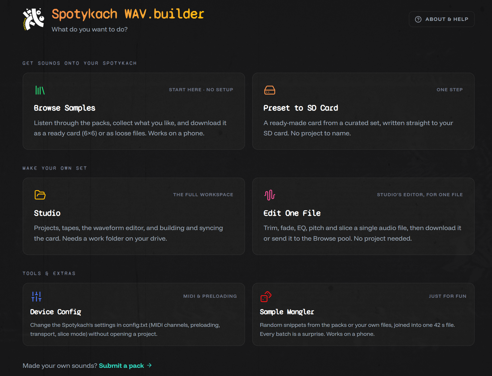
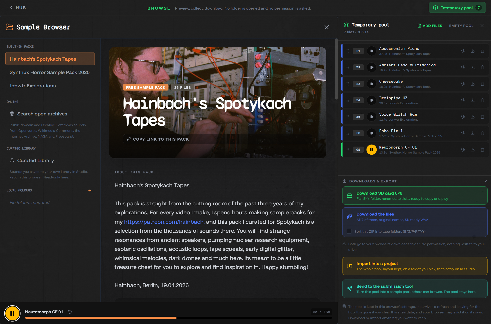
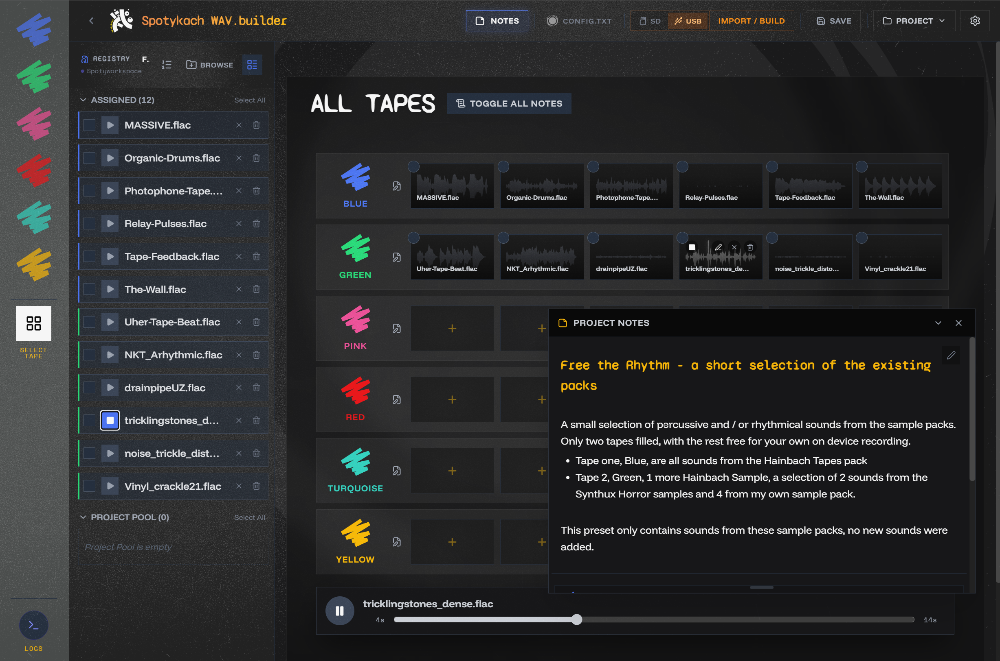
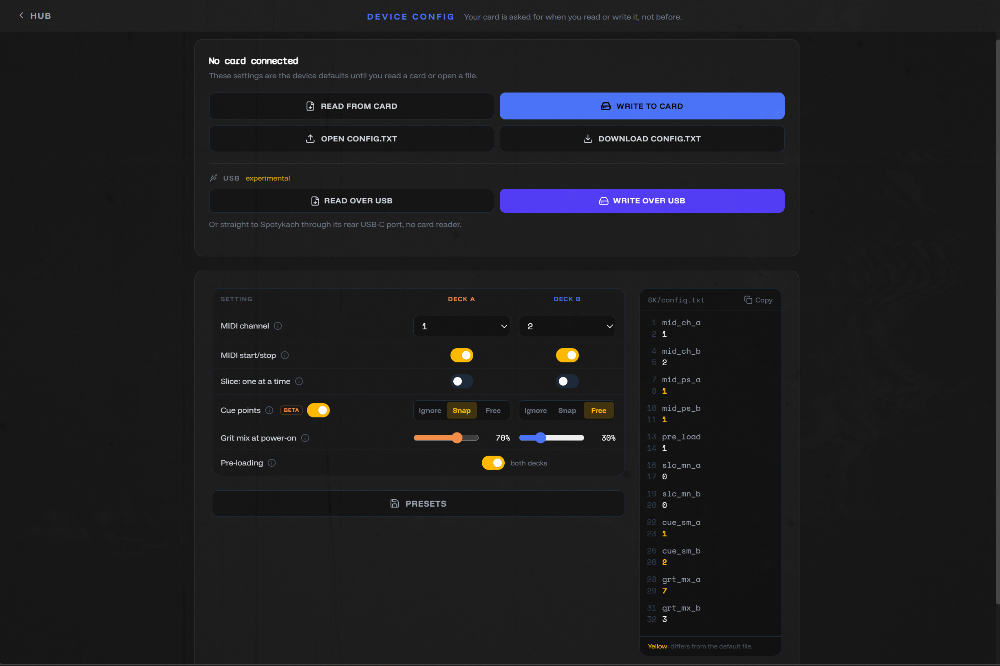

# [Title: e.g. "Meet WAV.builder" / "WAV.builder: getting sounds onto your Spotykach"]

*[Teaser: one line for the blog listing]*

<!-- Each section: the brief in the comment says what it's for. Write underneath, delete the comment when done. -->

## [1. Intro]

<!--
What WAV.builder is in two or three sentences: a free browser app for getting sounds onto the
Spotykach SD card, from the sample packs or your own files, in the right format and folder layout.
Say it's an overview, not a manual. Link: [app URL].
-->

WAV.builder today is an app to help organise samples, allowing to bring sounds, whether your own or those from the Synthux Sample Packs, to the Spotykach SD card. And in the other direction allowing you to easily import what you wrote to the SD card on the device while you were playing it.
This article is an overview and not a manual. 

## [2. Where it came from]

<!--
The origin story in your words: why you started it, what problem it solved for you, first version
(first commit 6 Feb 2026, v1.0.0 on 9 Feb). How it grew: projects, tapes, the editor, sample packs,
Studio. How it ended up connected to Synthux.
-->

I built WAV.builder as an easy tool to get sounds onto the Spotykach SD card, formatted in the correct way. Really it was originally meant to write all caps .WAV files in the correct wav formatting. As that was a requirement for the device to read them. We now actually can use lower caps .wav as well, but the frustrations of not being able to easily save an all caps 1.WAV in Windows is the origin story.
Along the way I kept thinking it'd be nice if I could x y z ... Many months later it's quite a capable tool with many functions, I'm still in doubt on many things, from UI to UX to design, it's all on the table to me still; but I use it myself and do find it usefull in my day to day use of Spotykach. I hope it can be for you too.

It's all open source, so if you want to contribute or rip it apart to build your own tool. You're free to consider my app as a use case study.

## [3. Trying to film it all]

<!--
You tried to film one tutorial covering every feature. It didn't work out, and here's the edit.
Keep it short and light. Use it as the bridge: there was too much to show in one go, and that's
part of why the app was rebuilt.
-->

[VIDEO: outtakes edit]

## [4. From one app to a hub with doors]

<!--
v4 "Pervak" (19 Aug 2026). Before: one app with a setup wizard asking for a work folder, an SD card
and a project name before you saw anything, even if you only came to listen to a sample.
After: a hub. Each door does one job, has its own link you can bookmark or share, and nothing asks
for a folder until something is actually written. Most doors need no setup at all.
-->

## [5. The doors]

<!--
A short tour, one or two sentences per door, grouped the way the hub groups them. Describe what
each is *for*, not how to use it. One screenshot per group, or per door where it adds something.
-->

### Get sounds onto your Spotykach

<!-- Browse Samples: listen, collect, download as a ready card (6×6) or loose files, works on a phone.
     Preset to SD Card: a ready-made card from a curated set, written straight to the SD card. -->

### Make your own set

<!-- Studio: the full workspace: projects, tapes, waveform editor, building and syncing the card.
     Edit One File: Studio's editor for a single file: trim, fade, EQ, pitch, slice. -->

### Tools & extras

<!-- Device Config: config.txt settings (MIDI channels, preloading, transport, slice mode) without a project.
     Sample Mangler: see section 8.
     Submit a pack: made your own sounds? There's a door for sending them in. -->

## [6. How the doors connect]

<!--
The doors are separate but they hand things to each other. A few examples, not the full list:
- Browse → Studio: one button hands the whole pool to a new project
- Edit One File → Browse pool
- Sample Mangler → WAV, Browse pool, Studio user library, or straight into a new Studio project
- The Mangler also lives inside Studio's editor (Tools menu)
- Preset to SD Card and Studio both write to the card
Optional: a small diagram here.
-->

## [7. A few words I use]

<!--
Short glossary, maybe as a list:
- Workspace / work folder: the folder on your drive where Studio keeps everything
- Project: one complete card's worth of sounds
- Tape: [your definition]
- Pool: the temporary collection in Browse (and the Mangler's source pool)
- Card: the SD card, and what ends up on it
Check these match the wording in the app.
-->

## [8. Spotlight: the Sample Mangler]

<!--
The newest door. Random snippets from the packs or your own files, joined into one file of up to
42 s with a cue point at each snippet, so slice mode jumps between them. Dice, seeds, keepers.
Hits and slices, step sequencer with MIDI. Desktop browser only. Let the videos do most of the work.
-->

[VIDEO: mangler 1]

[VIDEO: mangler 2]

## [9. What this isn't, and where to go next]

<!--
Not a guide: point to About & Help in the app, the news section on the hub, Discord (@jonwtr).
Invite feedback and pack submissions.
-->

## [10. Thanks]

<!-- Synthux, Vlad, testers, pack makers (Hainbach, ...), anyone else. -->
