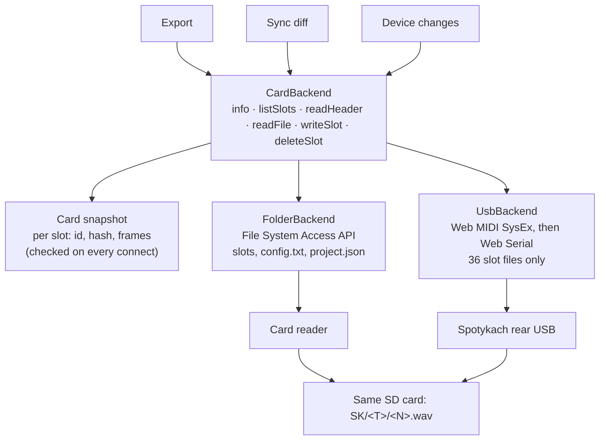

# WAV Builder — USB transfer integration plan

Oct 10, 2026 · Jon · revised Oct 12, 2026 (checked against the firmware source of both branches)

## Summary

WAV Builder can add USB as a second way to reach the card by putting a storage backend layer between the app and the card. The folder-on-disk path stays and remains the recommended route for full rebuilds. A Web Serial backend speaks Vlad's protocol. The file format barely changes: the firmware already reads 48 kHz / stereo / float32, and the uploader adds one `LIST/INFO/INAM` chunk holding the original file name.

- **Two tiers of access.** *Browse* needs only headers: names, lengths, cue counts and our file id for all 36 slots, in seconds, over either route. *Edit* needs the audio. That audio comes from the local project when the header identifies the file, and from a download only when it doesn't. The USB route is built around this split.
- **Our LIST chunk is in the wrong place.** Both WAV encoders write `LIST/INFO` *after* the audio. A header read (Vlad's LIST, or our own 4 KB read) never reaches it, so over USB our files show no name and no id. Moving `LIST` before `data` is the first change. It is safe on release firmware (see Compatibility).
- **Duplicate detection needs a cheaper key over USB.** Hashing a whole 16 MB slot means downloading it first, which takes 20–40 s per slot. The key becomes `ICMT.id` + `ICMT.h` from the header.
- **Size and format are fixed.** 48 kHz / stereo / float32 stays the on-card format, so no bit-depth options are planned here.

Based on the `uploader` branch at commit `550d80b` (protocol draft v1, still the branch head on Oct 11) and WAV Builder 4.1.3. Release firmware checked at `main` `7da8061`. The uploader firmware is unreleased, so the protocol can still change.

## Compatibility findings (verified Oct 11)

These came from reading `src/memory/wav.cpp`, `src/hw/card.cpp` and `src/ui/core.midi.cpp` on both branches, `web/index.html` on `uploader`, and our own encoders.

| Question | Answer | Source |
| --- | --- | --- |
| Does a bigger `LIST/INFO` (with `INAM`) break loading on release firmware? | No. `wav_header()` walks chunks and skips any it doesn't know, until it has both `fmt ` and `data`. It reads the first 32 KB (`Card::kChunk`), so anything before `data` must stay well under that. | `main` `wav.cpp`, `card.cpp` |
| Does moving `LIST` before `data` break release firmware? | No, for the same reason. Keep `cue ` **after** `data`: release firmware compares cue points found before `data` against a byte limit instead of frames, a bug that `uploader` fixes. | `main` / `uploader` `wav.cpp` diff |
| Where do we write `LIST` today? | After `data`, in both `wavEncoder.ts` and `useAudioConverter.ts`. Release firmware never looks at it. Vlad's `wav_info()` stops at `data` and never sees it. | our encoders |
| Does our current reader cope with `LIST` before `data`, or with `INAM`? | Yes. `readWavMetadata` walks every chunk, skips `data`, and ignores sub-chunks it doesn't know. So WAV Builder 4.1.3 reads the new files without changes. | `importUtils.ts` |
| Does Vlad's page keep our metadata? | No. It decodes every file with WebAudio and re-encodes it with only `INAM` and `cue `. A WAV Builder file uploaded through his page loses `IART`, `ITMP` and `ICMT`; only the name survives. | `web/index.html` `encodeWav()` |
| How do we tell old firmware apart? | Release firmware ignores SysEx. No reply within 3 s means the firmware has no USB transfer, which is what Vlad's page does too. | `main` `core.midi.cpp` |
| Device re-save | `DeckStorage::save()` writes a bare 44-byte header, on both branches. A slot re-recorded on the device loses all our metadata. | `storage.cpp`, spec §10.2 |
| Does the audio's start offset matter? | **Yes: it must be a multiple of 4** (found on hardware, Oct 11). `Card::init_read_audio` seeks to the audio and `f_read`s 32 KB at a time. FatFs fills the partial first sector itself, then has the SD DMA write whole sectors straight into the buffer at `buffer + (512 − start % 512)`. libDaisy's `SD_read` passes that address to the SDMMC IDMA unchanged, and the IDMA needs it word-aligned. Audio at 2 mod 4 shifts every sample by two bytes; the garbage floats (NaNs among them) give a burst of noise and then silence the whole engine, pass-through included, until a power cycle. The old 44-byte header was always aligned. | `uploader` `card.cpp`, `bleeptools/libDaisy` `sd_diskio.c` |

**What the header change does to the current detection (card reader route):**

- Bytes and size of every exported file change once (`INAM` added, `LIST` moved). `safeWriteBlob(..., 'content')` will see every slot as different, so the **first export after the update rewrites all slots once**. Put this in the release notes.
- `calculateSyncDiff` step B compares the card file's size with the version blob's size. Header size now varies with the name length, so this check becomes noisier. Replace it with the `data` size (frame count) plus `ICMT.h`.
- Cards written by 4.1.3 or earlier (with `LIST` after `data`) must still match. The reader already handles that over the card reader. Over USB, add a tail read (see Matching ladder).

## How Vlad's uploader works

The device switches its rear USB from MIDI to a virtual serial port, and the browser talks to it with Web Serial using a small binary request/response protocol. Everything below comes from `docs/usb-transfer.md` and `src/transfer/` on the `uploader` branch.

**Entering transfer mode**

1. The page sends the SysEx `F0 7D 53 4B 01 F7` to the Spotykach USB MIDI port (Web MIDI, `sysex: true`).
2. The device replies `F0 7D 53 4B 02 <status> F7`: OK, BUSY (deck loading, saving or recording) or NO_CARD. On OK it re-enumerates as USB CDC with VID/PID `0x0483:0x5740`. No reply within 3 s = old firmware.
3. The page opens the serial port (`navigator.serial`, filtered on that VID/PID) and sends HELLO, then LIST.
4. It leaves on EXIT, on Play A or Play B on the device, or after 10 s without a valid frame. Audio is muted during transfer mode.

**Frame:** magic `SK`, type, seq, length u32, CRC-32 u32, payload (12-byte header, little-endian). One request in flight at a time. Host timeout per request: 5 s.

| Command | What it does | Notes for WAV Builder |
| --- | --- | --- |
| HELLO | Protocol version, max chunk (32 KB), max frames, max cues (255), card total/free KiB, firmware version | Refuse on a different major version |
| LIST | All 36 slots in one reply | Header-only, see below |
| UPLOAD_BEGIN / DATA / COMMIT | Writes `<N>.tmp`, checks whole-file CRC-32, validates the header, renames to `<N>.wav` | Atomic: the old slot survives a failed upload |
| DOWNLOAD_OPEN / READ / CLOSE | Reads any byte range, up to 32 KB per read | A read of offset 0 gives you the header cheaply |
| DELETE | Removes a slot | Empty slot returns OK |
| EXIT | Back to MIDI | Also sent on tab close, best effort |

**Why LIST is instant.** Per slot the firmware stats the file, reads the first 4 KB (32 KB if the chunks before `data` are larger), and reads 8 KB after `data` to count cue points. It never touches the audio. Each entry returns flags (occupied, loadable, parsed), file size, frames, sample rate, cue count, channels, bits, and the name from `INAM`, **but only if `INAM` sits before `data`**.

**The filename method.** A standard `LIST` chunk of type `INFO` with an `INAM` sub-chunk: the original file name in UTF-8, including its extension, at most 64 bytes cut at a character boundary, NUL-terminated and padded to even length. Chunk order is `RIFF/WAVE`, `fmt `, `LIST`, `data`, then `cue ` if there are cue points. The firmware reads the first `INAM` in any `LIST/INFO` before `data`, so sharing the chunk with `IART`, `ITMP` and `ICMT` is fine.

**Two things the protocol does not give you:**

- **No content hash.** UPLOAD_BEGIN sends a CRC-32 to verify the transfer, but the device does not store it and LIST does not return one.
- **No `ICMT`.** LIST returns only `INAM`. Our id needs a separate header read per occupied slot.

## Current WAV Builder workflow

WAV Builder already tags every file it writes to the card with a UUID inside the WAV header, so it is closer to Vlad's format than it looks. It reaches the card only through a `FileSystemDirectoryHandle` (File System Access API).

**Where it lives (4.1.3):**

| Concern | File | What it does |
| --- | --- | --- |
| Data model | `src/types.ts` | `FileRecord` (uuid, name, originalName, versions) → `AudioVersion` (blob, processing, optional SHA-256 `hash`); `WavMetadata` (`id`, `hash`, tempo, processing, slicePoints) |
| WAV header | `src/lib/audio/wavEncoder.ts` (editor, processing), `src/utils/useAudioConverter.ts` (ffmpeg export path) | Write `LIST/INFO` with `IART` = "Spotykach Builder", `ITMP` = tempo, `ICMT` = JSON `{id, h, p, t}`. No `INAM`. **`LIST` and `cue ` both come after `data`.** Bytes built with `charCodeAt` |
| Write to card | `exportSDStructure` in `src/utils/exportUtils.ts` | Converts each slot via `onConvert`, writes `SK/<T>/<N>.wav` via `safeWriteBlob`, plus `SK/config.txt` and `SK/project.json` (the project identity) |
| Read card | `scanSKStructure`, `readWavMetadata` in `src/utils/importUtils.ts` | Lists `SK/<T>/*.wav` as `File` objects, parses `ICMT` back into `WavMetadata` (reads `LIST` wherever it is) |
| Compare | `calculateSyncDiff` (importUtils) | Per slot: UUID match via `ICMT.id` (fast path), then processing flags and file size; otherwise SHA-256 of both whole files. Builds the duplicates list from hashes |
| Device edits | `scanDeviceChanges` (importUtils) | Reads `SK/project.json`, flags a slot as changed when the file's `lastModified` is later than the export date |
| Background hashing | `App.tsx` ~line 1774 | Hashes assigned versions that have no `hash` yet |

**Why renames to `1.wav` don't break duplicate detection:** the identity travels inside the file (`ICMT.id` = the `FileRecord` uuid), and anything without it falls back to a SHA-256 of the bytes. Note that the export path fills `id`, `processing` and `tempo`, but leaves `h` (the hash) empty.

## Workflow: browse first, pull audio only to edit

This is the main user-facing idea. Over USB, reading headers is cheap and reading audio is expensive, so the app should never download audio unless the user asks for an edit that needs it.

| Step | Card reader | USB | What the user sees |
| --- | --- | --- | --- |
| Connect | Pick folder | SysEx → serial port → HELLO | Source badge, card size and free space (USB only) |
| Browse | Scan + header read | LIST + one 4 KB read per occupied slot (≈36 × 4 KB, 1–2 s) | Grid with name, length, cue count, and per slot: *in project*, *duplicate*, *changed on device*, or *unknown* |
| Edit a slot that's in the project | Local audio | Local audio, no download | Opens straight away |
| Edit or import an unknown slot | Read the file | Download (20–40 s for a full slot) | Explicit "Pull from device" action with progress |
| Push changes | Write changed slots | Upload changed slots only (20–40 s each) | Per-slot progress, time estimate before starting |

The user can switch routes at any time. The card snapshot (see Architecture) makes a USB push followed by a card-reader session (or the reverse) show as "in sync".

## Gaps: card reader vs USB

The slot audio maps one to one; the files outside the slots do not. USB transfer v1 only touches the 36 slot files, so `config.txt` and `project.json` still need the card reader.

| Feature | Card reader today | Over USB (protocol v1) | What to build |
| --- | --- | --- | --- |
| List slots | Directory scan, `File` per slot | LIST: one reply, header fields + `INAM` | Map LIST entries to a slot descriptor |
| Read `ICMT` (uuid) | `readWavMetadata(file)` | Not in LIST | DOWNLOAD_READ offset 0, 4 KB per occupied slot, then parse with the same reader. Legacy files: tail read |
| Whole-file SHA-256 | `hashBlob(file)` | Needs a full download (16 MB, 20–40 s per slot) | Avoid: write the hash into `ICMT.h` at export |
| Write a slot | `safeWriteBlob` | UPLOAD_BEGIN/DATA/COMMIT, atomic | USB writer with progress and abort |
| Skip unchanged slots | `safeWriteBlob(..., 'content')` compares bytes | Can't compare without downloading | Compare `ICMT.id` + `ICMT.h` + processing + frame count from the header read |
| Delete a slot | Directory `removeEntry` | DELETE | Direct map |
| Original filename | `FileRecord.originalName`, not in the file | `INAM` | Add `INAM` to our `LIST/INFO` |
| `config.txt` | Read and write | Not available | Card reader only; show it as locked in USB mode |
| `SK/project.json` | Written at export, read by `scanDeviceChanges` | Not available | Keep the identity in the project and in the WAV headers instead |
| Device-edit detection | `lastModified` > export date | No timestamps | Missing or mismatched `ICMT` = changed on the device |
| Card size / free space | Not shown | HELLO returns total and free KiB | Show it in the USB panel |
| Browser | Chromium (File System Access) | Chromium (Web Serial + Web MIDI SysEx) | Same requirement |

## Architecture

Put one `CardBackend` interface between the app and the card, with two implementations. Export, sync and device-change detection stop caring which route is in use.

Both routes end on the same files; only the folder route reaches `config.txt` and `project.json`.

**Slot descriptor** (what `listSlots()` + `readHeader()` return, same shape for both routes): tape, slot, occupied, loadable, file size, frames, cue count, `name` (`INAM`), `meta` (`WavMetadata` from `ICMT`, or null). The folder backend fills it from the `File`; the USB backend from LIST plus the header read. The sync diff runs on descriptors and only asks for `readFile()` when it truly needs the bytes.

**Switching sources and detecting a card swap**

1. The user picks a source per session: Card reader (folder handle) or USB (serial port). Remember the last choice, not a lock.
2. On every connect, list the slots and read each occupied slot's header. Build a fingerprint from (slot, frames, `ICMT.id`) for all 36 slots.
3. Compare the fingerprint with the project's card snapshot:
    - identical → same card, nothing changed;
    - same ids, different frames or hashes → same card, changed on the device or by another tool;
    - mostly different ids → probably a different card. Ask before syncing, and offer to bind the project to this card.
4. Over USB, also compare `card_total_kib` from HELLO; a different card size settles it. The folder route can't read the card size, so it relies on the fingerprint alone.
5. After any write, update the snapshot from what was actually written, whichever route did it.

## Filename and duplicate detection

Move `LIST/INFO` before `data`, add `INAM`, and fill `ICMT.h` with the content hash. Then one 4 KB header read per slot identifies every file, over USB or from the card reader.

**Header changes (both encoders, one shared builder)**

- New chunk order: `RIFF/WAVE`, `fmt `, `LIST/INFO` (`IART`, `INAM`, `ITMP`, `ICMT`), `data`, `cue `. This matches Vlad's spec §6.1 exactly, with extra sub-chunks.
- `INAM` = `FileRecord.originalName`, UTF-8, at most 64 bytes cut at a character boundary, NUL-terminated, padded to even length. Leave it out when the name is empty. Use the same truncation rule as Vlad's `utf8Truncate()` so names match across both tools.
- Encode `INAM` and `ICMT` with `TextEncoder`, and decode them with `TextDecoder` in `readWavMetadata`. Both encoders and the reader currently use `charCodeAt` / `fromCharCode`, which breaks on non-ASCII names.
- Fill `h` with the SHA-256 of the current version's blob (the background scan already stores it on `AudioVersion.hash`). Hash the source version, not the converted WAV, since the header itself is part of the WAV.
- Keep the audio on a multiple of 4 bytes (see Compatibility). The header is 44 bytes plus the `LIST` chunk, so `LIST` must be a multiple of 4; every sub-chunk is even, so it is off by 2 at most, and two extra NULs in `IART` fix it.
- Keep the whole `LIST` chunk well under 4 KB (it is about 300 bytes with a full hash and a 64-byte name). Larger still works, but LIST then rereads 32 KB per slot, and above 32 KB release firmware would fail to find `data`.
- Merge the two encoders' header code into one `buildWavHeader({ name, id, hash, processing, tempo, frames })` plus `buildCueChunk(points)`, so they can't drift.

**Matching ladder for a slot on the card**

1. `ICMT.id` matches a `FileRecord` → same file. Compare `h`, processing flags and frame count with the current version: equal is MATCH, different is UPDATED.
2. `ICMT.h` matches any known version hash → same audio under another record. List it as a duplicate.
3. Only `INAM` (written by Vlad's page, which drops `ICMT`, or by another tool) → a probable match on name + frame count. Ask the user to confirm.
4. No metadata (recorded or re-saved on the device) → unknown. Offer to import it, which means downloading it.

**Legacy files (written by 4.1.3 or earlier, `LIST` after `data`).** The card reader finds `ICMT` as today. Over USB, the offset-0 read finds nothing, so read the tail instead: from `44 + frames × 8` to `file_size` (only `LIST` and `cue ` live there, usually well under 4 KB). One extra small read, no download. These files move to the new layout the next time they are exported.

Only step 4 needs a full download, and only when the user chooses to import. A whole-file SHA-256 then still works for files that came in without metadata.

**Replacing `SK/project.json`**

USB can't reach `project.json`, so keep the identity on the app side. Store a card snapshot in the project: per slot `fileId`, `hash`, `frames`, time written, and whether it went over USB or the reader. `scanDeviceChanges` then compares the live header reads with that snapshot instead of using `lastModified`. Keep writing `project.json` when exporting through the reader, for backwards compatibility.

## Staying compatible with Vlad's branch and with release firmware

The USB firmware is a separate, unreleased branch. Nothing we merge to `main` may stop files from loading on the current release, and nothing USB-specific may show up for users on release firmware.

**What goes where**

| Work | Branch | Why it is safe |
| --- | --- | --- |
| Phase 0, Phase 1 (header + identity) | `main`, normal release | Only changes chunk order and adds `INAM`. Verified safe on release firmware; must still pass the hardware check below |
| Phase 2 (backend layer, folder only) | `main` | Refactor with no behaviour change; regression-tested on the card reader |
| Phase 3–4 (USB) | `feat/usb-transfer` until the USB firmware is released | Behind a feature flag (e.g. `?usb=1` or a settings toggle marked experimental). At runtime also gated: no SysEx reply in 3 s → "Your firmware does not support USB transfer" |

**Tracking upstream**

- Pin the commit in one place: `src/lib/usb/PROTOCOL.md` (or a header comment in `skLink.ts`) holds the upstream commit and protocol version our code was ported from.
- All protocol code lives in `src/lib/usb/skLink.ts` (frames, CRC, commands) and `src/lib/usb/usbBackend.ts` (mapping to `CardBackend`). A protocol change touches only these.
- Check the branch before each USB work session: `git ls-remote https://github.com/Synthux-Academy/Spotykach.git refs/heads/uploader` against the pinned commit; if it moved, diff `docs/usb-transfer.md`, `src/transfer/protocol.h` and `web/index.html`.
- Accept HELLO `proto_major == 1` only. Log `proto_minor` and `fw_version` so bug reports show which firmware was involved.
- Share our format notes with Vlad (the extra `INFO` sub-chunks, `ICMT` JSON) so his page's `readWavMetadata` and any future firmware writer leave them alone.

**Compatibility test checklist (run before each release that touches the header)**

- [x] New file loads on **release** firmware (`main` build): audio and length correct (Oct 11). Cue points are preserved in the file; the device doesn't use them yet
- [x] New file loads on the **uploader** firmware (Oct 11, after the alignment fix). LIST name not yet seen on the device
- [ ] Vlad's page lists our file with the right name and cue count
- [ ] WAV Builder 4.1.3 imports the new file and still reads `ICMT` (id, processing, tempo)
- [x] New WAV Builder still matches a card written by 4.1.3 (`LIST` after `data`) over the card reader: shown as **Sync · old header** and rewritten once by Standard Build (Oct 11). Over USB (tail read): covered by `check:wav`, to be tested in Phase 3
- [x] Non-ASCII name (e.g. `Ø café 音.wav`) round-trips, and a 70-byte name is cut at a character boundary (card file read back, Oct 11)
- [x] `npm run check:wav` passes: a JS port of the firmware's `wav_header()` and `wav_info()` parses every encoder output and finds `fmt `, `data`, `INAM` and the cue count (the repo has no test runner, so a plain node script is enough)

## Implementation plan

Start with the header changes: they help the card-reader path on their own and don't wait for the firmware release. The USB backend comes after, behind the same interface.

**Phase 0 — Prep**

- [x] Commit this plan (it is untracked) and keep it current as the source of truth
- [x] `scripts/check-wav-header.mjs` (`npm run check:wav`): firmware-parity parser and test vectors (see checklist). Ports the release load path, the uploader load path, and the uploader's LIST scan (`wav_info()`, `wav_cue_count()`, the 4 KB / 32 KB / 8 KB reads). It runs reference vectors in the target layout, edge cases, and the real `wavEncoder.ts` output. The ffmpeg path in `useAudioConverter.ts` is skipped until Phase 1 moves its header code into the shared builder. Phase 1 set `REQUIRE_LIST_BEFORE_DATA = true`.
- [x] Note the upstream commit and protocol version: `uploader` `550d80b61043a25e83d90c6a7ec294f28c665286`, protocol 1.0 (`kProtoMajor = 1`, `kProtoMinor = 0`), firmware version string `1.3.1`; `main` `7da80618c7e051189c575e766ff40594e622e910`. Both pinned in the script header; copy them to `src/lib/usb/PROTOCOL.md` in Phase 3

Phase 0 results (Oct 11):

- The target layout (`fmt `, `LIST/INFO`, `data`, `cue `) loads on both firmwares with correct frames and cues, and the USB LIST shows the name, including non-ASCII names and a 71-byte name cut to 62 bytes at a character boundary. A full `LIST` with a 64-byte name and a full hash is about 310 bytes before audio, well inside the 4 KB LIST read.
- Current `wavEncoder.ts` output loads on both firmwares. Over USB it shows no name, and the plan's tail read (`44 + frames × 8` to end of file) recovers `ICMT`, which confirms the legacy rule.
- Confirmed limits: a `LIST` over about 4 KB makes LIST re-read 32 KB; one over 32 KB stops both firmwares from finding `data`. A `cue ` before `data` is filtered against bytes on release firmware and against frames on the uploader branch, so `cue ` stays after `data`.

**Phase 1 — Header and identity (no firmware needed, ships on `main`)**

- [x] Shared `buildWavHeader()` / `buildCueChunk()` used by `wavEncoder.ts` and `useAudioConverter.ts`, with `TextEncoder`. Both encoders go through `assembleWav(pcm, metadata, sampleRate)` in `src/lib/audio/wavHeader.ts`
- [x] Move `LIST/INFO` before `data` in both encoders; keep `cue ` after `data`
- [x] Write `INAM` from `originalName` (falls back to `name`; 64-byte UTF-8 cut, same rule as Vlad's page). `name` is on `WavMetadata`; `exportSDStructure` passes it on both the direct-write and the ZIP path (the ZIP path passed no metadata at all before), and `toHardwareWav` (presets) now forwards metadata too
- [x] Fill `ICMT.h` at export from `AudioVersion.hash` (hashed first if missing)
- [x] Extend the reader: `readWavHeaderInfo()` in `wavHeader.ts` returns `frames`, `sampleRate` and metadata including `name`, decodes with `TextDecoder`, and takes a `Blob` or an `ArrayBuffer`. A buffer without a RIFF header is read as a bare chunk run, which is the legacy tail read. `readWavMetadata` in `importUtils.ts` wraps it
- [x] Rewrite the match step of `calculateSyncDiff` as the four-step ladder (`SyncSlotDiff.match`: `id`, `hash`, `bytes`, `name`); compare `ICMT.h`, then frames for hashless legacy files, instead of file size; the full-file hash is only the fallback when nothing of ours ties the files. Duplicates register a card file under `ICMT.h` when it has one
- [x] Store a card snapshot in the project state on every export: `AppState.cardSnapshot`, returned by the direct-write `exportSDStructure`, kept by both App call sites and saved in `project.json`. Not in `project-descriptor.json` yet
- [x] Release notes: the first export after updating rewrites every slot once (CHANGELOG, Unreleased)
- [x] Run the compatibility checklist, including the hardware check on release firmware (Oct 11: release and uploader firmware play the new files; a 4.1.3 card is matched and upgraded; `check:wav` passes, with `REQUIRE_LIST_BEFORE_DATA = true` and the audio-alignment rule). Still open, not blocking: Vlad's page listing our names, and 4.1.3 importing a new file

Phase 1 results (Oct 11):

- **Hardware test 1 (uploader firmware) failed, fixed since.** One of four files loaded as loud noise, then the engine went silent. Its audio started at byte 234 (2 mod 4), which the SD DMA can't read into the buffer correctly; see the Compatibility row. `buildInfoChunk` now pads `IART` so the audio always starts on a multiple of 4. `npm run check:wav` fails any file that doesn't, sweeps name lengths 0–70, and takes real files as arguments: `node scripts/check-wav-header.mjs D:/SK/B/1.WAV`. Re-export and retest on both firmwares.
- **Hardware test 3 passed (Oct 11):** release firmware plays the new files; Clean Mirror keeps non-WAV-Builder files in `SK`. A 4.1.3 card imported into an empty project pulls all slots, as it should. Imports now take the record name from `INAM` when the card file has one, and a slot matched by identical bytes (an import from a 4.1.3 card) is flagged `staleHeader` too, so the next build moves it to the current layout.
- **Hardware test 2 passed** after cleaning the card by hand and rewriting: all four files load. Cue points are written and read back by the app; the device doesn't use them yet, so only their preservation was checked.
- **Clean Mirror no longer deletes the `SK` folder.** It used `cleanDirectory(root, 'SK')`, which also removed the device's `MEM` file. Now it overwrites what WAV Builder owns (slots, `config.txt`, `project.json`, README) with no compare, deletes card-only slots through their decisions, and leaves the rest alone.
- **The preview couldn't force a rewrite.** Hash matching marked every slot in sync, every preset skipped in-sync slots, and with all slots skipped App never ran the export. Fixed: `SyncSlotDiff.staleHeader` flags a MATCH whose card file has no `ICMT.h` (4.1.3 layout) or misaligned audio, and Standard Build pushes those; Clean Mirror pushes every project slot.
- The sync preview shows the card file's `INAM` name, and a `name`-only match as "Same name?" instead of "Conflict".
- `scanDeviceChanges` still uses `project.json` and `lastModified`. Switching it to the snapshot belongs with the backend layer in Phase 2, where it stops taking a directory handle.
- Exports from Browse and the submission tool write pooled blobs without `onConvert`, so their files carry whatever header the editor wrote: the new layout, but no `INAM` or hash unless the blob had them.

**Phase 2 — Storage backend layer (`main`, no behaviour change)**

- [x] Define `CardBackend` in `src/lib/card/cardBackend.ts`: `info()`, `listSlots()`, `readHeader(t, s)`, `readFile(t, s, onProgress)`, `writeSlot(t, s, blob, { compare, onProgress, signal })`, `deleteSlot(t, s)`, returning `SlotDescriptor`s. Folder-only members are optional: `ensureLayout()`, `readConfig()`, `writeConfig()`, and `files` (read/write by path from the card root, for `README.md`, `SK/project.json` and the project mirror). Helpers: `readCardSlots()` (list + header per slot) and `slotFile()` (the descriptor's `File`, or a `readFile()`)
- [x] `FolderBackend` in `src/lib/card/folderBackend.ts`: takes over `scanSKStructure` (removed from `importUtils.ts`), writes through `safeWriteBlob`, deletes with `removeEntry`. Keeps the `File`s from the last listing, so header reads and hashes see what was listed
- [x] `exportSDStructure` takes `options.card`, falling back to a `FolderBackend` on `destinationHandle` or a picked folder, so its other callers are unchanged. `calculateSyncDiff(state, card)` and `scanDeviceChanges(card)` take the backend; App's five call sites build a `FolderBackend` from `sdHandle`
- [x] Regression test the card-reader export and sync before adding USB (on hardware, release firmware, Oct 11)

Phase 2 results (Oct 11):

- **Same output as before, checked in code.** A mock-filesystem script ran one scenario through the Phase 1 commit (`7da427f`, handles) and the backend: an export, a card-side foreign file, a changed slot, a removed slot, a changed `config.txt`, then a clean-mirror export with a delete. Snapshot, diff (statuses, matches, `staleHeader`, new/updated files, duplicates), device diff and the final card tree were identical.
- **Hardware regression test passed (Oct 11, release firmware).** Clean project on an empty card: the first Standard Build wrote every slot, `config.txt`, `project.json`, README and all six tape folders. A rebuild with no changes showed everything in sync and rewrote nothing. The files played on the device, which then wrote its `MEM` file. A foreign file added and a slot deleted on the computer showed up in the sync preview and imported. Clean Mirror with a delete removed the slot and kept `MEM`.
- `SlotDescriptor` has `fileName`, `size`, `lastModified` (folder only), the header fields (`frames`, `sampleRate`, `dataOffset`, `name`, `meta`) and `file` when the route has the bytes without a download. `occupied` is implied (listings hold occupied slots only); `loadable` comes with USB LIST in Phase 3.
- `SyncSlotDiff` gained `remote` (the descriptor). `remoteFile` is still filled on the folder route. The diff only needs bytes when nothing in the header ties the card file to the project file, but `newFiles` / `updatedFiles` still carry a `File` for `applySyncDiff`, so over USB they would download. Make those lazy in Phase 3.
- README and `SK/project.json` are now written through `safeWriteBlob` (atomic where the browser allows), not `createWritable()` in place. Same bytes.
- `scanDeviceChanges` still uses `project.json` and `lastModified`, now through `card.files` and the descriptors. Over USB it returns null, since `files` is folder-only. Switching it to the card snapshot is a behaviour change, so it is left for Phase 3, where USB needs it.
- Not moved: `configFile.ts` (Config mode reads and writes `config.txt` itself; folder-only, and USB can't reach the file) and App's SK backup copy (folder-only by nature).

**Phase 3 — USB backend (`feat/usb-transfer`, behind a flag)**

- [x] `skLink.ts`: frame encode/decode, CRC-32, seq, timeouts. Ported from `web/index.html` on the `uploader` branch (MIT); upstream pin and the differences from the page in `src/lib/usb/PROTOCOL.md`
- [x] Enter flow: Web MIDI with `sysex: true`, find the Spotykach output, send `F0 7D 53 4B 01 F7`, handle OK, BUSY, NO_CARD and no reply (old firmware)
- [x] Open the serial port filtered on `0x0483:0x5740`; reuse `getPorts()` so later sessions skip the picker. First use past the click's 5 s throws `NeedsAuthorizationError`; `authorizePort()` runs the picker from a fresh click
- [x] HELLO: refuse a different major version; firmware version and free space in `info()`; `max_frames` and `max_cues` checked before upload
- [x] `UsbBackend` in `src/lib/usb/usbBackend.ts`: LIST → `listSlots()`, DOWNLOAD_READ 0–4096 → `readHeader()` (plus a tail read from the end of `data`, for legacy `ICMT` and for cue points), upload with progress and abort
- [x] Copy the download retry logic (shrinking read size, 8 failures max) for the macOS tail-drop issue
- [x] Send EXIT on leave and on `beforeunload`; handle a disconnect mid-transfer
- [x] Free-space check before a batch: `checkSpace(writes)` (optional on `CardBackend`), sum of upload sizes vs `card_free_kib`, keeping in mind the temp file and old file exist side by side
- [x] Hardware test with the uploader firmware (Oct 12, Windows, below): connect, LIST, header reads, upload, download, non-float refusal, EXIT

Phase 3 results (Oct 11):

- **Upstream unchanged.** `uploader` is still at `550d80b`; pinned in `src/lib/usb/PROTOCOL.md`.
- **Behind `?usb=1`** (remembered in `localStorage`, `?usb=0` turns it off). Without the flag the USB code isn't loaded: it is a separate 19 kB chunk. With it, `window.skUsb` drives the backend from the console (`connect`, `authorize`, `slots`, `download`, `upload`, `remove`, `exit`) for hardware tests before the Phase 4 UI.
- **One operation at a time.** Every multi-request operation (LIST, an upload, a header read, a download) and HELLO go through `SkLink.exclusive()`. HELLO resets the device session, so a HELLO for the free space must never land inside an upload. PING only after 2 s without any request.
- **Header read = two small reads in one DOWNLOAD session**: the first 4 KB (32 KB if `data` isn't in it, like the firmware), then from the end of `data` to the end of the file when that is at most 64 KB. The tail gives legacy files their `ICMT` and new files their cue points (`cue ` stays after `data`). `readWavHeaderInfo()` now also returns `dataEnd`.
- **`writeSlot` compare over USB.** `always` uploads. `size` compares with LIST. `content` can't compare bytes, so it compares size, `ICMT.id`, `ICMT.h`, processing and frames from a header read; a blob without our id and hash is always uploaded. After an upload the listing entry is updated locally instead of re-running LIST, and HELLO refreshes the free space.
- **Uploads are checked first**, with a message that names the slot: 48 kHz, audio on a multiple of 4 bytes (the alignment bug), at most `max_frames` frames and `max_cues` cue points, and under the device's `TOO_LARGE` limit. WAV Builder's files are uploaded as they are; nothing is decoded or re-encoded.
- **`checkSpace`** walks the batch in order: each upload needs its full size free while the old file exists, then frees the old one; 64 KiB margin per file for clusters.
- **Simulated device test passed** (Node, the real `skLink.ts` + `usbBackend.ts` against a JS model of the firmware's service behind a fake serial port that splits replies at random): HELLO, LIST with a UTF-8 `INAM`, header read with id and hash in one read, legacy `ICMT` from the tail read, cues from the tail, skip on same id + hash, write on a changed hash, a 42 s download byte-exact with every fifth reply's tail dropped, abort mid-upload (old slot kept, device idle), concurrent calls serialized, misaligned audio refused, space check, delete, EXIT on close. Not a substitute for hardware: the real device's timing, the Windows driver rebinding and the MIDI port exclusivity are untested.
- **Hardware test still to do**, on the uploader firmware: open WAV Builder with `?usb=1`, then in the console `await skUsb.connect()`, `await skUsb.slots()` (names, ids, timing for 36 slots), `await skUsb.download('Blue', 1)` and `await skUsb.upload('Blue', 1)` with a WAV Builder export (throughput is logged), then check the slot plays. Windows first (spec §9.2).
- **First hardware run (Oct 12, Windows, uploader firmware).** Connect worked after granting the COM port: firmware `1.3.1`, protocol 1.0. An upload of a WAV Builder file (4 MB) took 8.9 s, **460 KB/s**, inside the spec's 400–800 KB/s, and the slot played on the device. Found:
  - A non-float WAV uploaded to 100% and was then refused by the device (`BAD_FORMAT`). The pre-upload check only looked at sample rate and alignment; it now checks the device's whole `is_loadable()` (format 3, 2 channels, 48 kHz, 32-bit, block align 8), so such a file is refused before the upload. `readWavHeaderInfo()` returns `audioFormat`, `channels`, `bitsPerSample` and `blockAlign`.
  - **Browse tier confirmed:** LIST plus a header read for 7 occupied slots took **0.6 s**. The four slots WAV Builder wrote showed their `INAM` name, `ICMT` id and hash, with the audio at 228–244 bytes (all multiples of 4). The three slots with a bare 44-byte header (uploaded from the console, or saved by the device) showed no metadata, as expected: step 4 of the matching ladder.
  - **Slice points were lost by Build SD** (a bug since before 4.1.3, not USB): the build took them from `file.metadata`, which the slice tool never updates. Fixed (now read from the version's WAV) and confirmed: the same version (`ICMT.h` `7661ad00…`) built before the fix shows 0 cues, after the fix 15, audio at byte 264. A second upload ran at 481 KB/s (7.3 MB in 14.7 s).
  - **Download confirmed:** Green 1 (7.3 MB) in 15.1 s, 470 KB/s, no lost replies on Windows. Uploaded again to Green 2 it lists the same name, id, hash and 15 cues, so the round trip is byte-exact.
  - **Importing that download into a slot lost its slices** (not USB; since before 4.1.3): `loadAndProcessAudio` re-encodes every imported file without metadata. It now keeps the source WAV's `cue `, tempo and `INAM`, and a dropped card file is named after its `INAM`.
  - **Refusal and exit confirmed:** a 16-bit integer WAV is refused before any upload ("48000 Hz, 2 ch, 16-bit integer PCM"). EXIT returns the device to MIDI; it plays and takes MIDI as before.
  - Closing Chrome's port picker by clicking outside it leaves the device in transfer mode (rings lit) with its MIDI port gone, so the next connect said "MIDI port not found". `connect()` now opens the port picker in that case (when the click still counts), and the error says what the lit rings mean. Phase 4 needs a visible "Authorise port" button for this.
- **Left for Phase 4**, since nothing uses USB in the app yet: make `newFiles` / `updatedFiles` in the sync diff lazy (today they would download every new or changed slot), switch `scanDeviceChanges` to the card snapshot (it returns null over USB), have `exportSDStructure` call `checkSpace` before a USB batch, and record `via: 'usb'` in the snapshot.

**Phase 4 — UI and switching (`feat/usb-transfer`)**

- [x] Source chooser in the sync modal (Import / Build SD): Card reader or USB. Not in the Export modal yet (see below)
- [x] "Authorise port" button that stays visible while the device waits in transfer mode (port picker closed by accident, or the click expired)
- [x] Browse view from headers only; "Pull from device" action for slots that aren't in the project. The sync modal is the browse view: over USB its card grid comes from LIST and header reads, and a pull or pool decision downloads the slot when the build runs
- [x] Card snapshot check on every connect, both sources (see Architecture)
- [x] In USB mode, show `config.txt` and project-copy options as "needs card reader"
- [x] Per-slot progress for USB writes and a time estimate before a batch (about 20–40 s per full slot)
- [x] Help text: Chromium only, close DAWs holding the MIDI port on Windows, `dialout` group on Linux
- [ ] Hardware test of the UI on the uploader firmware (below)
- [ ] Merge to `main` (flag still on) once the USB firmware is released; then remove the flag

Phase 4 results (Oct 12):

- **Upstream unchanged.** `uploader` is still at `550d80b`.
- **One connection, `usbSession`** (`src/lib/usb/usbSession.ts`): connect, authorise, disconnect and the HELLO info, as a small store with a React hook. The sync modal and `window.skUsb` share it, so they never fight over the port. It imports the protocol code only when connecting, so `skLink` and `usbBackend` stay separate chunks.
- **Source bar in the sync modal** (`CardSourceBar`, shown with `?usb=1` only): Card reader / USB, the connection state, Connect, Authorise port (while the device may be waiting in transfer mode), Disconnect, firmware and free space from HELLO, and a help list. The choice is remembered (`spotykach_cardSource`), not locked. Connecting, disconnecting or a lost connection rescans the modal. With no card folder picked, Import / Build SD opens on USB. With the flag on, a missing card shows in the bar instead of the blocking overlay, so the switch stays reachable.
- **The sync diff never downloads over USB.** On the card reader, a card file nothing in its header ties to the project is still compared by content. Over USB that stays a conflict, and duplicates use `ICMT.h` only. `newFiles` / `updatedFiles` carry `file` only on the reader and a `load()` that downloads, which `applySyncDiff` uses. In the simulator, a diff of four 0.6 MB slots read 16 KB.
- **Pull over USB:** the confirm step downloads each pulled or pooled slot with progress ("Downloading Pink 1 from Spotykach… 40%") before the build writes anything.
- **Build over USB:** `exportSDStructure` runs `checkSpace` on the whole batch first (sizes estimated from each version's WAV header or duration), and refuses before any upload when it doesn't fit. Uploads report per-slot progress. The snapshot records `via: 'usb'` and the card size (`CardSnapshot.totalKiB`). An `AbortSignal` is plumbed through (between slots, and mid-upload), but nothing in the UI cancels yet.
- **Card snapshot check** (`src/lib/card/cardSnapshot.ts`): every sync diff carries `cardCheck`, the live headers against the project's snapshot. Per slot: same, changed, new or removed. The card is called different when most of the files the project wrote are gone, or (USB) the card size differs. The modal shows one line: what changed since this project last wrote the card, or that it looks like a different card and a build binds the project to it.
- **`scanDeviceChanges`** compares with the snapshot when it can't reach `project.json` (USB). The card reader keeps `project.json` and file dates.
- **USB mode in the modal:** `config.txt` is left out of the decisions and shown as "needs the card reader", Snapshot card to project is shown off, and the confirmation gives a time ("About 3 min over USB, 80 MB at about 450 KB/s"). Card slots without a file at hand still show as occupied in both grids (`SlotEntry.occupied`), with no play button.
- **Fixed on the way:** the sync modal kept its rows from the first scan, so Refresh (and now a source switch) showed a stale table. It now rebuilds them from each new diff, keeping the mode.
- **Simulated device test passed** (the Phase 3 device model, the real `importUtils`, `exportUtils` and `UsbBackend`): diff statuses over USB (id match, stale 4.1.3 header, unmatched conflict, card-only, project-only) with no audio read; `load()` byte-exact with progress; `applySyncDiff` through `load()`; a batch that doesn't fit refused before any upload; per-slot progress; the snapshot's `via` and card size; snapshot verdicts (same, re-saved on the device, other card size, files gone); `scanDeviceChanges` from the snapshot.
- **Not done:** a source chooser in the Export modal (its SD export picks a folder; over USB the sync modal does the same job), a Cancel button for a running USB batch, and playing a card slot over USB (it would need a download).
- **Hardware test to do**, uploader firmware, Windows first: open with `?usb=1`, Import / Build SD, switch to USB, Connect (and Authorise port on first use, also after closing the picker by clicking outside it). Check the grid against `skUsb.slots()`, the snapshot line after a build, a Standard Build of a few changed slots (progress, time estimate, then in sync on rescan), a pull of a card-only slot into the project, a build that doesn't fit, unplugging mid-upload (the slot keeps its old file, the modal shows Connect again), then the same project over the card reader showing in sync.

## Open questions and risks

- **Protocol stability.** The spec is marked draft v1 and the branch is unreleased. Check `proto_major` in HELLO and keep the link code in two files so a v1.1 (pipelined uploads) is a contained change.
- **Ask Vlad: return `ICMT` in LIST?** If LIST also returned the `ICMT` bytes (or a short hash field), the per-slot header reads would disappear. They cost about 36 × 4 KB, probably 1–2 s in total, so this is a nice-to-have.
- **Ask Vlad: keep foreign `INFO` sub-chunks when re-encoding?** His page drops `ICMT`, so a WAV Builder file pushed through his page loses its id. Copying through any `LIST/INFO` sub-chunks other than `INAM` would keep both tools' identity intact.
- **Tell Vlad: his page has the same alignment bug.** `encodeWav()` writes a header of `64 + INAM padded` bytes, so the audio lands on 2 mod 4 whenever the padded `INAM` size is 2 mod 4: names of 1, 5, 9… bytes, or 4, 8, 12… bytes (`kick.wav` puts the audio at byte 74). Either pad there too, or fix it once in the firmware: bounce unaligned buffers in `SD_read`, or have `init_read_audio` read from a sector-aligned offset and copy from inside the buffer.
- **Ask Vlad: share the INAM encoder?** Using the exact same `INAM` rules as his page means files moved between the two tools keep their names. We copy `utf8Truncate()` for now.
- **Device re-saves drop metadata.** `DeckStorage::save()` writes a bare 44-byte header (spec §10.2). Those slots land in step 4 of the ladder until that's fixed. A firmware fix that keeps the old `LIST` chunk on re-save would help both tools.
- **One app at a time.** If Vlad's page or a DAW holds the serial or MIDI port, WAV Builder can't connect. Show a clear message rather than a generic error.
- **Windows driver binding.** The device uses the same VID/PID in MIDI and CDC mode, which Windows may cache badly (spec §9.2). Test there early.
- **No card serial in the browser.** Neither USB v1 nor the File System Access API exposes a card ID, so the card snapshot is a fingerprint, not a guarantee.
- **Timing.** About 20–40 s per full slot means a 36-slot push can take 15–25 minutes over USB. Keep the card reader as the recommended path for full rebuilds, and show the estimate before a long batch.
