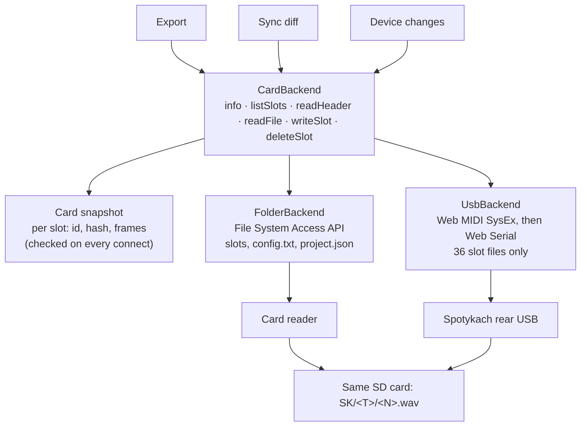

# WAV Builder — USB transfer integration plan

Oct 10, 2026 · Jon · revised Oct 11, 2026 (checked against the firmware source of both branches)

## Summary

WAV Builder can add USB as a second way to reach the card by putting a storage backend layer between the app and the card. The folder-on-disk path stays and remains the recommended route for full rebuilds. A Web Serial backend speaks Vlad's protocol. The file format barely changes: the firmware already reads 48 kHz / stereo / float32, and the uploader adds one `LIST/INFO/INAM` chunk holding the original file name.

- **Two tiers of access.** *Browse* needs only headers: names, lengths, cue counts and our file id for all 36 slots, in seconds, over either route. *Edit* needs the audio. That audio comes from the local project when the header identifies the file, and from a download only when it doesn't. The USB route is built around this split.
- **Our LIST chunk is in the wrong place.** Both WAV encoders write `LIST/INFO` *after* the audio. A header read (Vlad's LIST, or our own 4 KB read) never reaches it, so over USB our files show no name and no id. Moving `LIST` before `data` is the first change. It is safe on release firmware (see Compatibility).
- **Duplicate detection needs a cheaper key over USB.** Hashing a whole 16 MB slot means downloading it first, which takes 20–40 s per slot. The key becomes `ICMT.id` + `ICMT.h` from the header.
- **Size and format are fixed.** 48 kHz / stereo / float32 stays the on-card format, so no bit-depth options are planned here.

Based on the `uploader` branch at commit `550d80b` (protocol draft v1, still the branch head on Oct 11) and WAV Builder 4.1.3. Release firmware checked at `main` `7da8061`. The uploader firmware is unreleased, so the protocol can still change.

## Compatibility findings (verified Oct 11)

These came from reading `src/memory/wav.cpp`, `src/hw/card.cpp` and `src/ui/core.midi.cpp` on both branches, `web/index.html` on `uploader`, and our own encoders.

| Question | Answer | Source |
| --- | --- | --- |
| Does a bigger `LIST/INFO` (with `INAM`) break loading on release firmware? | No. `wav_header()` walks chunks and skips any it doesn't know, until it has both `fmt ` and `data`. It reads the first 32 KB (`Card::kChunk`), so anything before `data` must stay well under that. | `main` `wav.cpp`, `card.cpp` |
| Does moving `LIST` before `data` break release firmware? | No, for the same reason. Keep `cue ` **after** `data`: release firmware compares cue points found before `data` against a byte limit instead of frames, a bug that `uploader` fixes. | `main` / `uploader` `wav.cpp` diff |
| Where do we write `LIST` today? | After `data`, in both `wavEncoder.ts` and `useAudioConverter.ts`. Release firmware never looks at it. Vlad's `wav_info()` stops at `data` and never sees it. | our encoders |
| Does our current reader cope with `LIST` before `data`, or with `INAM`? | Yes. `readWavMetadata` walks every chunk, skips `data`, and ignores sub-chunks it doesn't know. So WAV Builder 4.1.3 reads the new files without changes. | `importUtils.ts` |
| Does Vlad's page keep our metadata? | No. It decodes every file with WebAudio and re-encodes it with only `INAM` and `cue `. A WAV Builder file uploaded through his page loses `IART`, `ITMP` and `ICMT`; only the name survives. | `web/index.html` `encodeWav()` |
| How do we tell old firmware apart? | Release firmware ignores SysEx. No reply within 3 s means the firmware has no USB transfer, which is what Vlad's page does too. | `main` `core.midi.cpp` |
| Device re-save | `DeckStorage::save()` writes a bare 44-byte header, on both branches. A slot re-recorded on the device loses all our metadata. | `storage.cpp`, spec §10.2 |

**What the header change does to the current detection (card reader route):**

- Bytes and size of every exported file change once (`INAM` added, `LIST` moved). `safeWriteBlob(..., 'content')` will see every slot as different, so the **first export after the update rewrites all slots once**. Put this in the release notes.
- `calculateSyncDiff` step B compares the card file's size with the version blob's size. Header size now varies with the name length, so this check becomes noisier. Replace it with the `data` size (frame count) plus `ICMT.h`.
- Cards written by 4.1.3 or earlier (with `LIST` after `data`) must still match. The reader already handles that over the card reader. Over USB, add a tail read (see Matching ladder).

## How Vlad's uploader works

The device switches its rear USB from MIDI to a virtual serial port, and the browser talks to it with Web Serial using a small binary request/response protocol. Everything below comes from `docs/usb-transfer.md` and `src/transfer/` on the `uploader` branch.

**Entering transfer mode**

1. The page sends the SysEx `F0 7D 53 4B 01 F7` to the Spotykach USB MIDI port (Web MIDI, `sysex: true`).
2. The device replies `F0 7D 53 4B 02 <status> F7`: OK, BUSY (deck loading, saving or recording) or NO_CARD. On OK it re-enumerates as USB CDC with VID/PID `0x0483:0x5740`. No reply within 3 s = old firmware.
3. The page opens the serial port (`navigator.serial`, filtered on that VID/PID) and sends HELLO, then LIST.
4. It leaves on EXIT, on Play A or Play B on the device, or after 10 s without a valid frame. Audio is muted during transfer mode.

**Frame:** magic `SK`, type, seq, length u32, CRC-32 u32, payload (12-byte header, little-endian). One request in flight at a time. Host timeout per request: 5 s.

| Command | What it does | Notes for WAV Builder |
| --- | --- | --- |
| HELLO | Protocol version, max chunk (32 KB), max frames, max cues (255), card total/free KiB, firmware version | Refuse on a different major version |
| LIST | All 36 slots in one reply | Header-only, see below |
| UPLOAD_BEGIN / DATA / COMMIT | Writes `<N>.tmp`, checks whole-file CRC-32, validates the header, renames to `<N>.wav` | Atomic: the old slot survives a failed upload |
| DOWNLOAD_OPEN / READ / CLOSE | Reads any byte range, up to 32 KB per read | A read of offset 0 gives you the header cheaply |
| DELETE | Removes a slot | Empty slot returns OK |
| EXIT | Back to MIDI | Also sent on tab close, best effort |

**Why LIST is instant.** Per slot the firmware stats the file, reads the first 4 KB (32 KB if the chunks before `data` are larger), and reads 8 KB after `data` to count cue points. It never touches the audio. Each entry returns flags (occupied, loadable, parsed), file size, frames, sample rate, cue count, channels, bits, and the name from `INAM`, **but only if `INAM` sits before `data`**.

**The filename method.** A standard `LIST` chunk of type `INFO` with an `INAM` sub-chunk: the original file name in UTF-8, including its extension, at most 64 bytes cut at a character boundary, NUL-terminated and padded to even length. Chunk order is `RIFF/WAVE`, `fmt `, `LIST`, `data`, then `cue ` if there are cue points. The firmware reads the first `INAM` in any `LIST/INFO` before `data`, so sharing the chunk with `IART`, `ITMP` and `ICMT` is fine.

**Two things the protocol does not give you:**

- **No content hash.** UPLOAD_BEGIN sends a CRC-32 to verify the transfer, but the device does not store it and LIST does not return one.
- **No `ICMT`.** LIST returns only `INAM`. Our id needs a separate header read per occupied slot.

## Current WAV Builder workflow

WAV Builder already tags every file it writes to the card with a UUID inside the WAV header, so it is closer to Vlad's format than it looks. It reaches the card only through a `FileSystemDirectoryHandle` (File System Access API).

**Where it lives (4.1.3):**

| Concern | File | What it does |
| --- | --- | --- |
| Data model | `src/types.ts` | `FileRecord` (uuid, name, originalName, versions) → `AudioVersion` (blob, processing, optional SHA-256 `hash`); `WavMetadata` (`id`, `hash`, tempo, processing, slicePoints) |
| WAV header | `src/lib/audio/wavEncoder.ts` (editor, processing), `src/utils/useAudioConverter.ts` (ffmpeg export path) | Write `LIST/INFO` with `IART` = "Spotykach Builder", `ITMP` = tempo, `ICMT` = JSON `{id, h, p, t}`. No `INAM`. **`LIST` and `cue ` both come after `data`.** Bytes built with `charCodeAt` |
| Write to card | `exportSDStructure` in `src/utils/exportUtils.ts` | Converts each slot via `onConvert`, writes `SK/<T>/<N>.wav` via `safeWriteBlob`, plus `SK/config.txt` and `SK/project.json` (the project identity) |
| Read card | `scanSKStructure`, `readWavMetadata` in `src/utils/importUtils.ts` | Lists `SK/<T>/*.wav` as `File` objects, parses `ICMT` back into `WavMetadata` (reads `LIST` wherever it is) |
| Compare | `calculateSyncDiff` (importUtils) | Per slot: UUID match via `ICMT.id` (fast path), then processing flags and file size; otherwise SHA-256 of both whole files. Builds the duplicates list from hashes |
| Device edits | `scanDeviceChanges` (importUtils) | Reads `SK/project.json`, flags a slot as changed when the file's `lastModified` is later than the export date |
| Background hashing | `App.tsx` ~line 1774 | Hashes assigned versions that have no `hash` yet |

**Why renames to `1.wav` don't break duplicate detection:** the identity travels inside the file (`ICMT.id` = the `FileRecord` uuid), and anything without it falls back to a SHA-256 of the bytes. Note that the export path fills `id`, `processing` and `tempo`, but leaves `h` (the hash) empty.

## Workflow: browse first, pull audio only to edit

This is the main user-facing idea. Over USB, reading headers is cheap and reading audio is expensive, so the app should never download audio unless the user asks for an edit that needs it.

| Step | Card reader | USB | What the user sees |
| --- | --- | --- | --- |
| Connect | Pick folder | SysEx → serial port → HELLO | Source badge, card size and free space (USB only) |
| Browse | Scan + header read | LIST + one 4 KB read per occupied slot (≈36 × 4 KB, 1–2 s) | Grid with name, length, cue count, and per slot: *in project*, *duplicate*, *changed on device*, or *unknown* |
| Edit a slot that's in the project | Local audio | Local audio, no download | Opens straight away |
| Edit or import an unknown slot | Read the file | Download (20–40 s for a full slot) | Explicit "Pull from device" action with progress |
| Push changes | Write changed slots | Upload changed slots only (20–40 s each) | Per-slot progress, time estimate before starting |

The user can switch routes at any time. The card snapshot (see Architecture) makes a USB push followed by a card-reader session (or the reverse) show as "in sync".

## Gaps: card reader vs USB

The slot audio maps one to one; the files outside the slots do not. USB transfer v1 only touches the 36 slot files, so `config.txt` and `project.json` still need the card reader.

| Feature | Card reader today | Over USB (protocol v1) | What to build |
| --- | --- | --- | --- |
| List slots | Directory scan, `File` per slot | LIST: one reply, header fields + `INAM` | Map LIST entries to a slot descriptor |
| Read `ICMT` (uuid) | `readWavMetadata(file)` | Not in LIST | DOWNLOAD_READ offset 0, 4 KB per occupied slot, then parse with the same reader. Legacy files: tail read |
| Whole-file SHA-256 | `hashBlob(file)` | Needs a full download (16 MB, 20–40 s per slot) | Avoid: write the hash into `ICMT.h` at export |
| Write a slot | `safeWriteBlob` | UPLOAD_BEGIN/DATA/COMMIT, atomic | USB writer with progress and abort |
| Skip unchanged slots | `safeWriteBlob(..., 'content')` compares bytes | Can't compare without downloading | Compare `ICMT.id` + `ICMT.h` + processing + frame count from the header read |
| Delete a slot | Directory `removeEntry` | DELETE | Direct map |
| Original filename | `FileRecord.originalName`, not in the file | `INAM` | Add `INAM` to our `LIST/INFO` |
| `config.txt` | Read and write | Not available | Card reader only; show it as locked in USB mode |
| `SK/project.json` | Written at export, read by `scanDeviceChanges` | Not available | Keep the identity in the project and in the WAV headers instead |
| Device-edit detection | `lastModified` > export date | No timestamps | Missing or mismatched `ICMT` = changed on the device |
| Card size / free space | Not shown | HELLO returns total and free KiB | Show it in the USB panel |
| Browser | Chromium (File System Access) | Chromium (Web Serial + Web MIDI SysEx) | Same requirement |

## Architecture

Put one `CardBackend` interface between the app and the card, with two implementations. Export, sync and device-change detection stop caring which route is in use.

Both routes end on the same files; only the folder route reaches `config.txt` and `project.json`.

**Slot descriptor** (what `listSlots()` + `readHeader()` return, same shape for both routes): tape, slot, occupied, loadable, file size, frames, cue count, `name` (`INAM`), `meta` (`WavMetadata` from `ICMT`, or null). The folder backend fills it from the `File`; the USB backend from LIST plus the header read. The sync diff runs on descriptors and only asks for `readFile()` when it truly needs the bytes.

**Switching sources and detecting a card swap**

1. The user picks a source per session: Card reader (folder handle) or USB (serial port). Remember the last choice, not a lock.
2. On every connect, list the slots and read each occupied slot's header. Build a fingerprint from (slot, frames, `ICMT.id`) for all 36 slots.
3. Compare the fingerprint with the project's card snapshot:
    - identical → same card, nothing changed;
    - same ids, different frames or hashes → same card, changed on the device or by another tool;
    - mostly different ids → probably a different card. Ask before syncing, and offer to bind the project to this card.
4. Over USB, also compare `card_total_kib` from HELLO; a different card size settles it. The folder route can't read the card size, so it relies on the fingerprint alone.
5. After any write, update the snapshot from what was actually written, whichever route did it.

## Filename and duplicate detection

Move `LIST/INFO` before `data`, add `INAM`, and fill `ICMT.h` with the content hash. Then one 4 KB header read per slot identifies every file, over USB or from the card reader.

**Header changes (both encoders, one shared builder)**

- New chunk order: `RIFF/WAVE`, `fmt `, `LIST/INFO` (`IART`, `INAM`, `ITMP`, `ICMT`), `data`, `cue `. This matches Vlad's spec §6.1 exactly, with extra sub-chunks.
- `INAM` = `FileRecord.originalName`, UTF-8, at most 64 bytes cut at a character boundary, NUL-terminated, padded to even length. Leave it out when the name is empty. Use the same truncation rule as Vlad's `utf8Truncate()` so names match across both tools.
- Encode `INAM` and `ICMT` with `TextEncoder`, and decode them with `TextDecoder` in `readWavMetadata`. Both encoders and the reader currently use `charCodeAt` / `fromCharCode`, which breaks on non-ASCII names.
- Fill `h` with the SHA-256 of the current version's blob (the background scan already stores it on `AudioVersion.hash`). Hash the source version, not the converted WAV, since the header itself is part of the WAV.
- Keep the whole `LIST` chunk well under 4 KB (it is about 300 bytes with a full hash and a 64-byte name). Larger still works, but LIST then rereads 32 KB per slot, and above 32 KB release firmware would fail to find `data`.
- Merge the two encoders' header code into one `buildWavHeader({ name, id, hash, processing, tempo, frames })` plus `buildCueChunk(points)`, so they can't drift.

**Matching ladder for a slot on the card**

1. `ICMT.id` matches a `FileRecord` → same file. Compare `h`, processing flags and frame count with the current version: equal is MATCH, different is UPDATED.
2. `ICMT.h` matches any known version hash → same audio under another record. List it as a duplicate.
3. Only `INAM` (written by Vlad's page, which drops `ICMT`, or by another tool) → a probable match on name + frame count. Ask the user to confirm.
4. No metadata (recorded or re-saved on the device) → unknown. Offer to import it, which means downloading it.

**Legacy files (written by 4.1.3 or earlier, `LIST` after `data`).** The card reader finds `ICMT` as today. Over USB, the offset-0 read finds nothing, so read the tail instead: from `44 + frames × 8` to `file_size` (only `LIST` and `cue ` live there, usually well under 4 KB). One extra small read, no download. These files move to the new layout the next time they are exported.

Only step 4 needs a full download, and only when the user chooses to import. A whole-file SHA-256 then still works for files that came in without metadata.

**Replacing `SK/project.json`**

USB can't reach `project.json`, so keep the identity on the app side. Store a card snapshot in the project: per slot `fileId`, `hash`, `frames`, time written, and whether it went over USB or the reader. `scanDeviceChanges` then compares the live header reads with that snapshot instead of using `lastModified`. Keep writing `project.json` when exporting through the reader, for backwards compatibility.

## Staying compatible with Vlad's branch and with release firmware

The USB firmware is a separate, unreleased branch. Nothing we merge to `main` may stop files from loading on the current release, and nothing USB-specific may show up for users on release firmware.

**What goes where**

| Work | Branch | Why it is safe |
| --- | --- | --- |
| Phase 0, Phase 1 (header + identity) | `main`, normal release | Only changes chunk order and adds `INAM`. Verified safe on release firmware; must still pass the hardware check below |
| Phase 2 (backend layer, folder only) | `main` | Refactor with no behaviour change; regression-tested on the card reader |
| Phase 3–4 (USB) | `feat/usb-transfer` until the USB firmware is released | Behind a feature flag (e.g. `?usb=1` or a settings toggle marked experimental). At runtime also gated: no SysEx reply in 3 s → "Your firmware does not support USB transfer" |

**Tracking upstream**

- Pin the commit in one place: `src/lib/usb/PROTOCOL.md` (or a header comment in `skLink.ts`) holds the upstream commit and protocol version our code was ported from.
- All protocol code lives in `src/lib/usb/skLink.ts` (frames, CRC, commands) and `src/lib/usb/usbBackend.ts` (mapping to `CardBackend`). A protocol change touches only these.
- Check the branch before each USB work session: `git ls-remote https://github.com/Synthux-Academy/Spotykach.git refs/heads/uploader` against the pinned commit; if it moved, diff `docs/usb-transfer.md`, `src/transfer/protocol.h` and `web/index.html`.
- Accept HELLO `proto_major == 1` only. Log `proto_minor` and `fw_version` so bug reports show which firmware was involved.
- Share our format notes with Vlad (the extra `INFO` sub-chunks, `ICMT` JSON) so his page's `readWavMetadata` and any future firmware writer leave them alone.

**Compatibility test checklist (run before each release that touches the header)**

- [ ] New file loads on **release** firmware (`main` build): audio, length and cue points correct
- [ ] New file loads on the **uploader** firmware, and its LIST shows the name
- [ ] Vlad's page lists our file with the right name and cue count
- [ ] WAV Builder 4.1.3 imports the new file and still reads `ICMT` (id, processing, tempo)
- [ ] New WAV Builder still matches a card written by 4.1.3 (`LIST` after `data`), over the card reader and over USB (tail read)
- [ ] Non-ASCII name (e.g. `Ø café 音.wav`) round-trips, and a 70-byte name is cut at a character boundary
- [ ] A `scripts/check-wav-header.mjs` parity check passes: a JS port of the firmware's `wav_header()` and `wav_info()` parses every encoder output and finds `fmt `, `data`, `INAM` and the cue count (the repo has no test runner, so a plain node script is enough)

## Implementation plan

Start with the header changes: they help the card-reader path on their own and don't wait for the firmware release. The USB backend comes after, behind the same interface.

**Phase 0 — Prep**

- [ ] Commit this plan (it is untracked) and keep it current as the source of truth
- [ ] `scripts/check-wav-header.mjs`: firmware-parity parser and test vectors (see checklist)
- [ ] Note the upstream commit (`550d80b`) and protocol version in the plan and later in `src/lib/usb/`

**Phase 1 — Header and identity (no firmware needed, ships on `main`)**

- [ ] Shared `buildWavHeader()` / `buildCueChunk()` used by `wavEncoder.ts` and `useAudioConverter.ts`, with `TextEncoder`
- [ ] Move `LIST/INFO` before `data` in both encoders; keep `cue ` after `data`
- [ ] Write `INAM` from `originalName` (64-byte UTF-8 cut, same rule as Vlad's page). Thread `name` through `WavMetadata` and the `onConvert` call in `exportSDStructure`
- [ ] Fill `ICMT.h` at export from `AudioVersion.hash` (hash it first if missing)
- [ ] Extend `readWavMetadata`: return `name` (from `INAM`) and `frames`, decode with `TextDecoder`, and accept an `ArrayBuffer` (header or tail bytes), not only a `File`
- [ ] Rewrite the match step of `calculateSyncDiff` as the four-step ladder; compare frames instead of file size; use `ICMT.h` before falling back to a full hash
- [ ] Store a card snapshot in the project state on every export
- [ ] Release notes: the first export after updating rewrites every slot once
- [ ] Run the compatibility checklist, including the hardware check on release firmware

**Phase 2 — Storage backend layer (`main`, no behaviour change)**

- [ ] Define `CardBackend`: `info()`, `listSlots()`, `readHeader(t, s)`, `readFile(t, s, onProgress)`, `writeSlot(t, s, blob, onProgress, signal)`, `deleteSlot(t, s)`, `readConfig()`, `writeConfig()` (the last two optional), returning slot descriptors
- [ ] `FolderBackend`: wrap the existing `scanSKStructure`, `safeWriteBlob` and `removeEntry` code
- [ ] Make `exportSDStructure`, `calculateSyncDiff` and `scanDeviceChanges` call the backend instead of a `FileSystemDirectoryHandle`
- [ ] Regression test the card-reader export and sync before adding USB

**Phase 3 — USB backend (`feat/usb-transfer`, behind a flag)**

- [ ] `skLink.ts`: frame encode/decode, CRC-32, seq, timeouts. Port it from `web/index.html` on the `uploader` branch rather than rewriting it
- [ ] Enter flow: Web MIDI with `sysex: true`, find the Spotykach output, send `F0 7D 53 4B 01 F7`, handle OK, BUSY, NO_CARD and no reply (old firmware)
- [ ] Open the serial port filtered on `0x0483:0x5740`; reuse `getPorts()` so later sessions skip the picker
- [ ] HELLO: refuse a different major version; show firmware version and free space; use `max_frames` and `max_cues` to validate before upload
- [ ] `UsbBackend`: LIST → `listSlots()`, DOWNLOAD_READ 0–4096 → `readHeader()` (tail read for legacy files), upload with progress and abort
- [ ] Copy the download retry logic (shrinking read size, 8 failures max) for the macOS tail-drop issue
- [ ] Send EXIT on leave and on `beforeunload`; handle a disconnect mid-transfer
- [ ] Free-space check before a batch: sum of upload sizes vs `card_free_kib`, keeping in mind the temp file and old file exist side by side

**Phase 4 — UI and switching (`feat/usb-transfer`)**

- [ ] Source chooser in the export and sync modals: Card reader or USB
- [ ] Browse view from headers only; "Pull from device" action for slots that aren't in the project
- [ ] Card snapshot check on every connect, both sources (see Architecture)
- [ ] In USB mode, show `config.txt` and project-copy options as "needs card reader"
- [ ] Per-slot progress for USB writes and a time estimate before a batch (about 20–40 s per full slot)
- [ ] Help text: Chromium only, close DAWs holding the MIDI port on Windows, `dialout` group on Linux
- [ ] Merge to `main` (flag still on) once the USB firmware is released; then remove the flag

## Open questions and risks

- **Protocol stability.** The spec is marked draft v1 and the branch is unreleased. Check `proto_major` in HELLO and keep the link code in two files so a v1.1 (pipelined uploads) is a contained change.
- **Ask Vlad: return `ICMT` in LIST?** If LIST also returned the `ICMT` bytes (or a short hash field), the per-slot header reads would disappear. They cost about 36 × 4 KB, probably 1–2 s in total, so this is a nice-to-have.
- **Ask Vlad: keep foreign `INFO` sub-chunks when re-encoding?** His page drops `ICMT`, so a WAV Builder file pushed through his page loses its id. Copying through any `LIST/INFO` sub-chunks other than `INAM` would keep both tools' identity intact.
- **Ask Vlad: share the INAM encoder?** Using the exact same `INAM` rules as his page means files moved between the two tools keep their names. We copy `utf8Truncate()` for now.
- **Device re-saves drop metadata.** `DeckStorage::save()` writes a bare 44-byte header (spec §10.2). Those slots land in step 4 of the ladder until that's fixed. A firmware fix that keeps the old `LIST` chunk on re-save would help both tools.
- **One app at a time.** If Vlad's page or a DAW holds the serial or MIDI port, WAV Builder can't connect. Show a clear message rather than a generic error.
- **Windows driver binding.** The device uses the same VID/PID in MIDI and CDC mode, which Windows may cache badly (spec §9.2). Test there early.
- **No card serial in the browser.** Neither USB v1 nor the File System Access API exposes a card ID, so the card snapshot is a fingerprint, not a guarantee.
- **Timing.** About 20–40 s per full slot means a 36-slot push can take 15–25 minutes over USB. Keep the card reader as the recommended path for full rebuilds, and show the estimate before a long batch.
