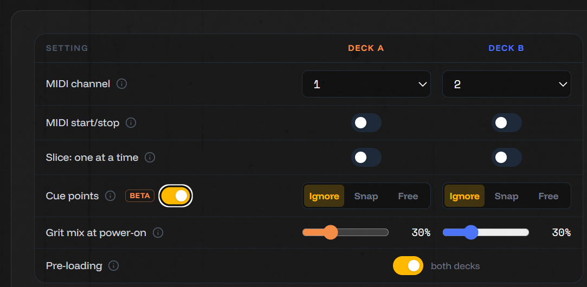

# config.txt: cue points and grit mix

The **config.txt** editor (the tape icon in Studio, or **Device Config** from the hub) has caught up with the firmware, and it's a lot more compact: one row per setting, Deck A and Deck B side by side, and the file it will write right next to it, updating as you change things.

Two new settings:

- **Cue points (beta).** If a sample has its own cue points, for example slices made in the editor's **Slicer**, Spotykach can use them. **Snap**: start and size snap to the cue points (hold ALT for a free size). **Free**: start snaps, size is free (ALT snaps it). **Ignore**, the default, slices as if the cue points weren't there. Switch the row on to write it into your config.txt; the device reads it from firmware 1.3.0 on.
- **Grit mix at power-on.** Where each deck's grit mix starts when the device powers on, 0 to 100%. Needs firmware 1.4.0 beta 4 or later, which also fixes this setting for all three grit modes.

Settings are read when Spotykach powers on, so restart it after writing a new config.txt.

The Slicer's "not implemented on Spotykach" warning is gone too: cue points do play now, as a beta. A longer post with a demo of Snap and Free is on its way.

[Full changelog](https://github.com/jonwaterschoot/spotykach_WAV_builder/blob/main/CHANGELOG.md)
