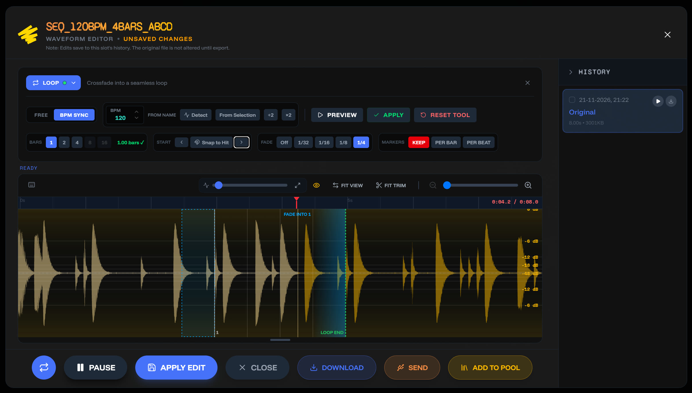

# Loops in time: BPM Sync in the editor

The editor's **Loop** tool has a second mode. **Free** works as before: any selection, with a crossfade folded over the seam. **BPM Sync** makes the loop a whole number of bars at a tempo, exact to the sample.

- **Tempo.** If the file's name or tag carries a BPM (`SEQ_120BPM_4BARS`), it is filled in. **Detect** finds it in the audio, and **From Selection** reads it from a selection you already know is a loop. Got half or double? **÷2** and **×2**.
- **Bars.** Pick 1, 2, 4, 8 or 16 and the selection becomes exactly that many bars. A grid on the wave numbers the bars and marks the loop end.
- **Start.** **Snap to Hit** puts the loop on the nearest hit; the arrows move it a beat at a time to find the downbeat.
- **Fade.** Off by default: a clean cut on the grid. Set it to a 1/32 to 1/4 note and the end of the loop blends into what led into bar 1, so it runs on into its first beat as the recording did. The loop keeps its length, and the downbeat is left untouched. It needs audio before the loop start, so it can't be used at the very start of a file.
- **Markers.** On Apply, a slice marker per bar or per beat, ready for the Slicer and Spotykach's cue points. The tempo is saved in the file too.

Looping itself got tighter as well: with the loop button on, playback now wraps on the exact sample instead of drifting at the seam, in every tool.

[Full changelog](https://github.com/jonwaterschoot/spotykach_WAV_builder/blob/main/CHANGELOG.md)
