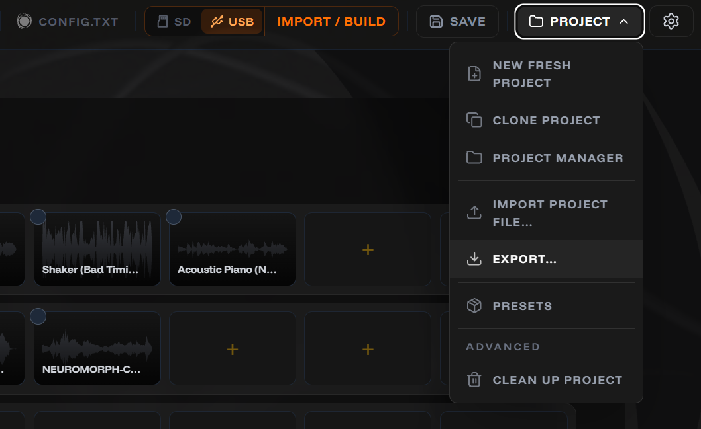

# Import and export, streamlined

Getting a project out of WAV Builder and back in is simpler now, and each choice says where it leads. Both start in the **Project** menu: **Import project file…** and **Export…**.

**Export** has three choices:

- **Project file**: the whole project in one zip, to keep or to open on another computer.
- **SD card folder**: the `SK` folder for the card, with every file renamed to the slot Spotykach reads it from.
- **Audio files**: the WAV files, to use elsewhere.

Downloads are named after the project. Making a preset for the official library? **Prepare a submission** is at the bottom of the Export window.

**Import project file** opens a project file as a project in your work folder, older exports too. If that project is already there, you see what differs before anything is replaced.

Working without a work folder? Save, Import and Export now say that your work lives in this browser only, and offer to move it to a folder on your computer.

[Full changelog](https://github.com/jonwaterschoot/spotykach_WAV_builder/blob/main/CHANGELOG.md)
