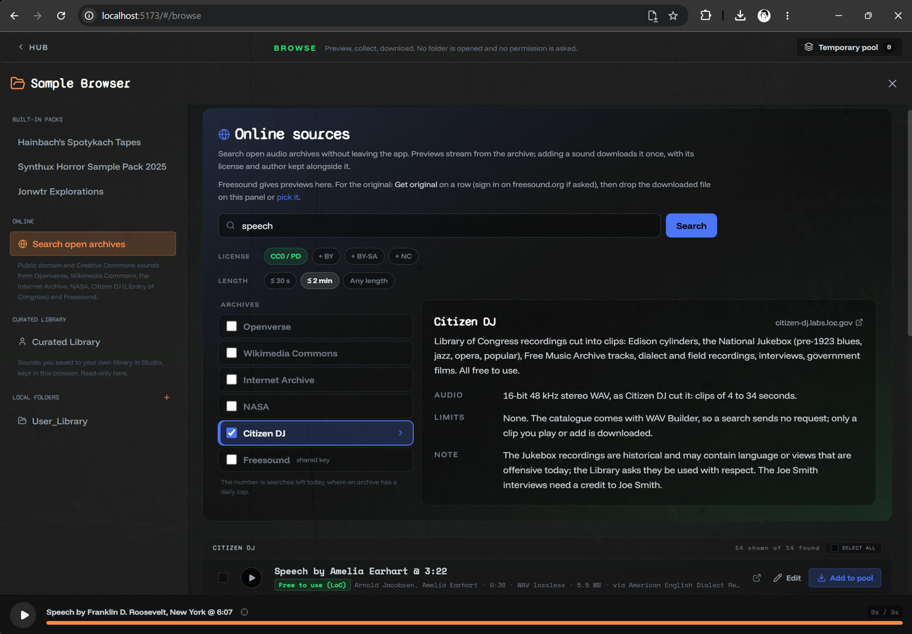

# Citizen DJ: Library of Congress clips in the sample browser

On the lookout for cool sampling material that's free to use, Fabio found [Citizen DJ](https://citizen-dj.labs.loc.gov/), a Library of Congress project that cuts recordings from its collections into ready-made clips for making music. It's now one of the archives under **Search open archives**.

So you can now search that collection for things like speeches by Franklin D. Roosevelt or Amelia Earhart, ragtime and jazz on Edison cylinders and pre-1923 records, dialect and field recordings, or interviews with musicians. About 4,000 clips of 4 to 34 seconds, all as WAV.

- **Free to use**, including in music you sell. Each clip keeps its performers, year and source.
- **The Joe Smith interviews** need a credit to Joe Smith, so they appear when *+ BY* is on.
- **The Jukebox recordings** are historical and may contain language or views that are offensive today. The Library asks that they be used with respect.

[Full changelog](https://github.com/jonwaterschoot/spotykach_WAV_builder/blob/main/CHANGELOG.md)
