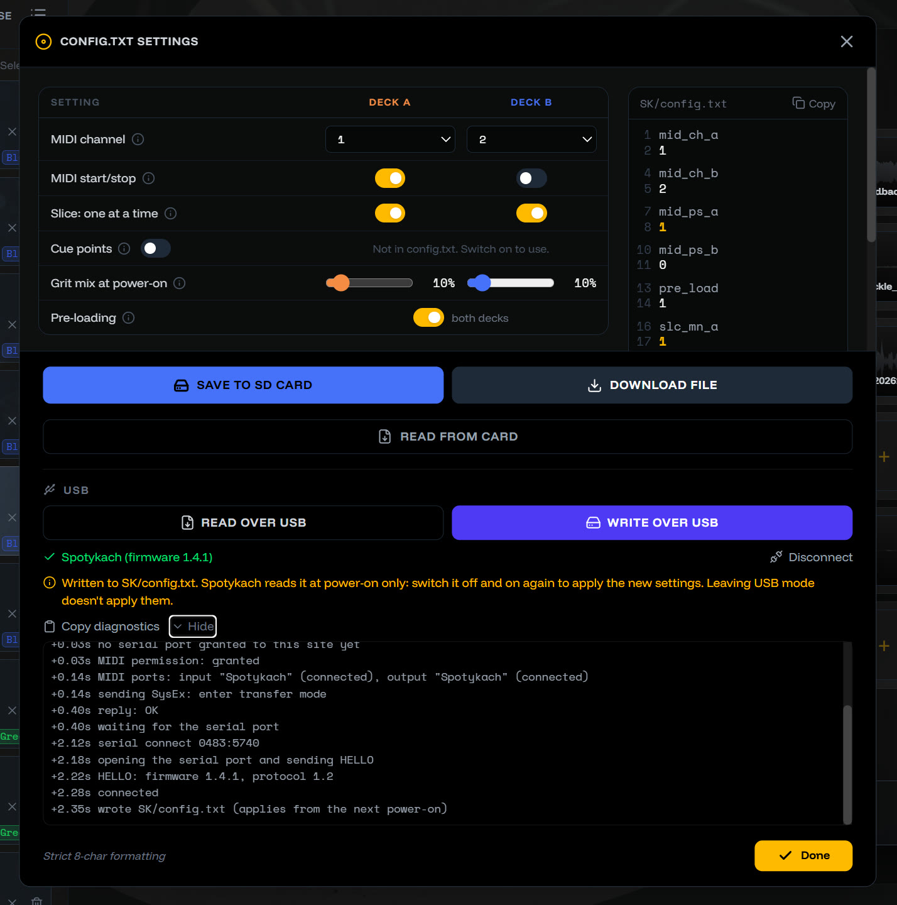

# Firmware 1.4.1 for USB transfer

Spotykach firmware **1.4.1** is out: get it from [Synthux](https://www.synthux.academy/firmware/spotykach/spotykach/v1.4.1). It's now the version WAV Builder recommends for USB transfer; 1.4.0 still works.

The Spotykach and WAV Builder now run the same transfer code on both ends of the cable. In testing on Windows it moved files a little faster than 1.4.0. On Linux, the first connect after Spotykach switches to transfer mode now waits for the system to free the port, so it no longer fails.

Writing `config.txt` over USB got a reminder: Spotykach reads the file only at power-on. Leaving USB mode doesn't apply it, so switch the device off and on again. The note stays on screen until you do something else over USB.

Also fixed: in Studio's config window, **Save to SD Card** saved to the work folder even with a card open. It now writes to the card.

[Full changelog](https://github.com/jonwaterschoot/spotykach_WAV_builder/blob/main/CHANGELOG.md)
