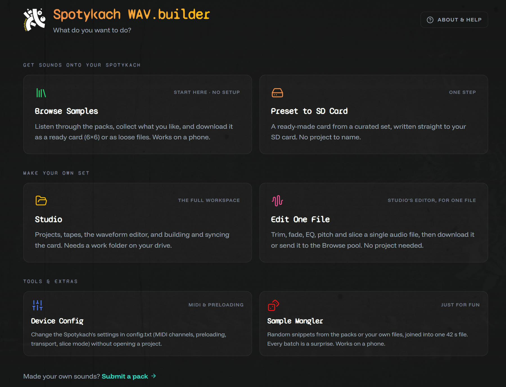
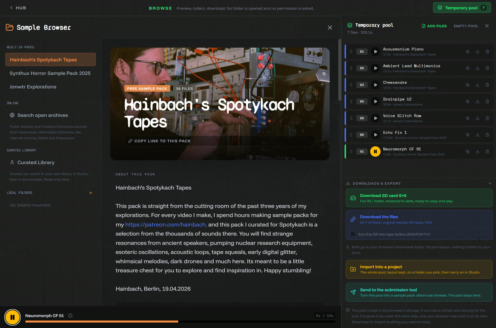
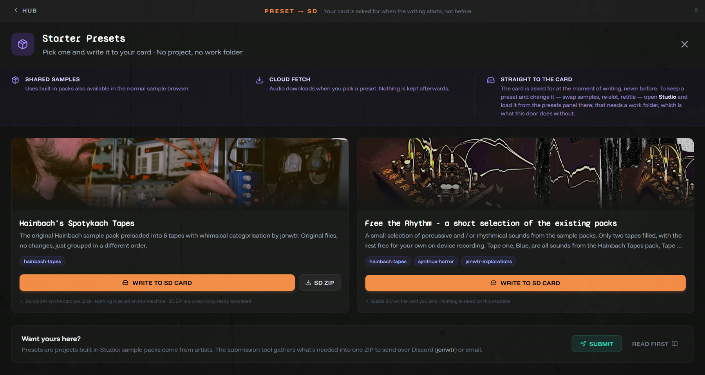
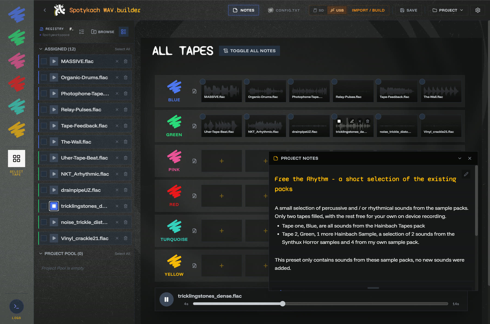
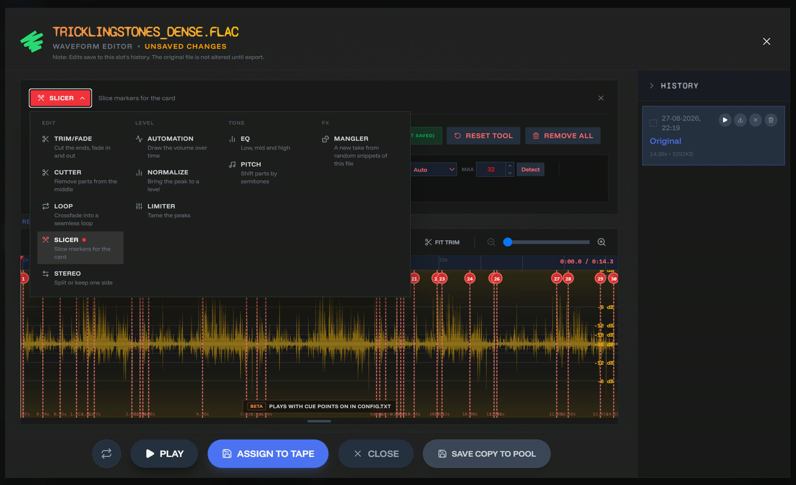
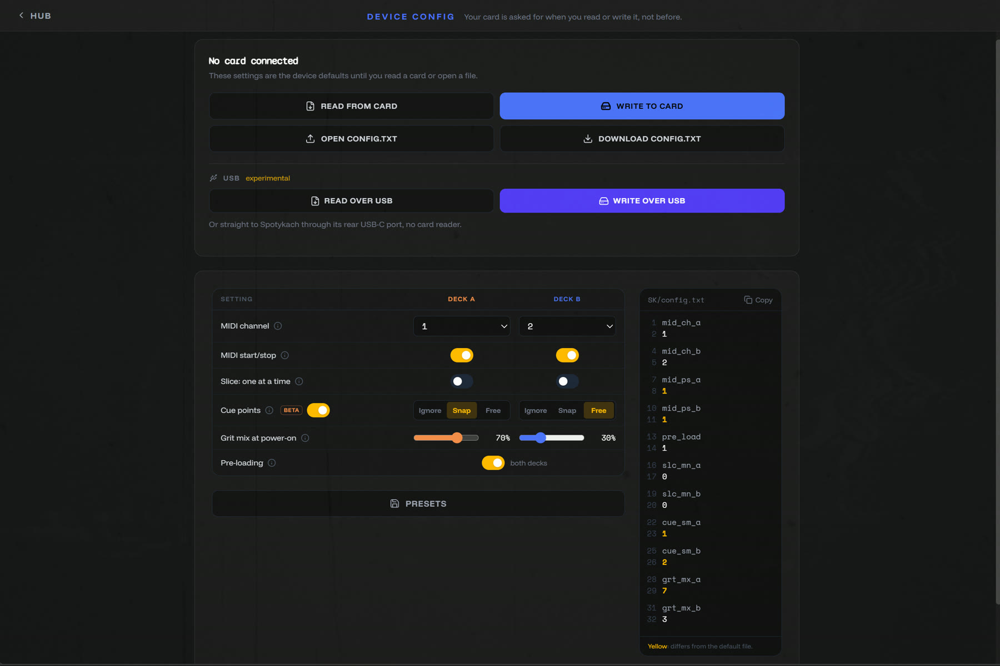

# Meet WAV.builder: getting sounds onto your Spotykach

*Organise your Spotykach samples, sync the SD card both ways, edit and build new files, or browse sample packs from the community and guest artists.*

WAV.builder is a free browser app for organising your Spotykach samples. It gets sounds onto the SD card, your own or from the Synthux sample packs, and brings back what you recorded to the card while playing. It ranges from a full Studio to a small editor for Spotykach's config.txt.

This is an overview, not a manual.

## Where it came from

I started WAV.builder as a one-job converter: take audio files and write them as all-caps `.WAV` files in the exact format Spotykach needed. Saving a file called `1.WAV` on Windows is surprisingly fiddly, and that frustration is the whole origin story. (Spotykach reads lowercase `.wav` now too.)

Then I kept thinking "it'd be nice if it could also…". Eight months on, it does a lot. I'm still unsure about plenty, from UI to UX to design, it's all still on the table, but I use it every time I play Spotykach and find it genuinely useful. I hope you will too.

It's all open source, and contributions are welcome.

## Trying to film it all

I've tried several times to record a video tour. My mistake was thinking I could cover everything in one 20-minute take. Over a few months, every attempt ended the same way: I'd hit a bug I wanted to fix first, stumble over my words and drift off topic, or my chronic pain would break the flow, and it was back to take one.

Here's the proof :P

[Watch the outtakes on YouTube](https://youtu.be/DM7hVPvqovQ)

There's simply too much to show in one go, which is also part of why the app got split up.

## From one app to a hub with doors

Up to v3, everything lived in one app: what's now the Studio door. Before you saw anything, a setup wizard asked for a work folder, an SD card and a project name, even if you only came to hear a sample.

v4 "Pervak" (August 2026) turned it into a hub with doors. Each door does one job and has its own link, so you can bookmark or share it. That made the sample packs easy to share, and it means you can drop a single sample into the editor, trim, normalise or EQ it, and download just that file to put in the right SK folder yourself. Most doors need no setup at all.

## The doors

The hub groups its six doors in three rows.

### Get sounds onto your Spotykach

#### Browse Samples

Listen through the packs, collect what you like and download it as a ready card (6×6) or as loose files. Works on a phone.

Grab single files, or collect them into the **pool**. There you can arrange them into tape slots, open them in the editor and download the lot as an SK folder, or hand the whole pool to a new Studio project in one click. It's a trimmed-down Studio without the workspace or projects: the session lives in your browser, so treat it as temporary.

#### Preset to SD Card

A ready-made card from a curated set, written straight to your SD card.

Take the Hainbach tapes: from the 36 samples Hainbach gave us, I made my own sorting across the 6×6 slots. Write it straight to a prepared card, or open the preset in Studio to swap files or leave a few slots free.

### Make your own set

#### Studio

The full workspace, and where I spend most of my time. The first time, you pick a folder on your drive where it keeps your projects and settings. From there you can:

- make as many projects as you like, each one a card's worth of sounds
- rearrange slots and work on every file with the full editor
- bring in samples from the pool, the sample browser or your drive. The browser can hold a personal collection, or point at folders on your computer so you can audition before copying anything in
- keep notes and titles per project, handy for remembering how you played a set
- change the look, set up locations and turn on optional backups in Settings

When you're ready, **sync** writes the project to the card, in the same window you use to import from it. I've worked hard on making syncing robust: the tricky part is staying consistent while files get written and renamed to the `SK/B/1.wav` layout.

#### Edit One File

Studio's editor, for a single file: trim, fade, EQ, pitch and slice, then download it or send it to the Browse pool. No project needed.

These are jobs I'd normally open a DAW or Audacity for. You may still prefer your own tools, but having them in the app saves an export and re-import. Beyond trimming and normalising, things like volume automation and pitch-shifting a section are handy for taming a sample with a nasty bit in it.

### Tools & extras

#### Device Config

Spotykach reads its settings (MIDI channels, preloading, transport, cue points) from `config.txt` on the SD card. This door edits that file without opening a project; Spotykach picks up the changes at the next reboot.

#### Sample Mangler

I'd sketched this concept a while back, but a friend pushed me to build it: while I was showing him Spotykach, he asked if I had a sample made of lots of short snippets.

That's what it makes. Feed it sources (the packs or your own files), pick or tweak a preset, and it spits out one scrambled collage of up to 42 s, with a cue point at every snippet so slice mode can jump between them. For that, set the deck's Cue points to Snap in Device Config; the default, Ignore, slices as if they weren't there. It can also generate drum hits and arrange them in its step sequencer. Export, re-mangle. Mangle, rinse, repeat. Every batch is a surprise, and it works on a phone. Try recording your own voice on your phone and mangling that: quick and fun.

The sequencer speaks MIDI too: send clock and notes to Spotykach or other gear, add LFOs and automation. Things you'd normally do in a DAW, but I'm a mini DAW too ;-)

Send the result out as a WAV, to the Browse pool, to your Studio library or into a new Studio project. The Mangler also lives inside Studio's editor, under Tools.

Bonus: it can also export for the Dirtywave M8, which reads the same slice points.

[Watch the Sample Mangler on YouTube](https://www.youtube.com/watch?v=jI-iRUhHxcw)

#### Submit a pack

Below the doors: *Made your own sounds? Submit a pack.* If you'd like to contribute one, follow that link and get in touch!

## Where to go next

I hope this gives you an idea of what the app can do, and why it's built the way it is. For the details, About & Help is in the app, and new features land in the news on the hub.

Found a bug, or something that annoys you? Reach out on Discord (@jonwtr). Would you rather have a drastically different app, for another need or style? Reuse any part of mine, or rip it apart and treat it as a case study; its licence explicitly allows that.

But mostly, have fun playing Spotykach, and if my app adds to that fun, let me know. This is a passion project and an endless learning opportunity for me.

## Thanks

Thanks to Synthux, and Roey in particular, for building an ecosystem that embraces open source and encourages this kind of work. To Vlad, who built the firmware: I admire your work, and you're always willing to explain things and even accept a few PRs so my app can use everything Spotykach offers. And to the testers, and everyone who has submitted samples or is thinking about it.

Keep on looping, we'll meet at the playground carousel,
Jon