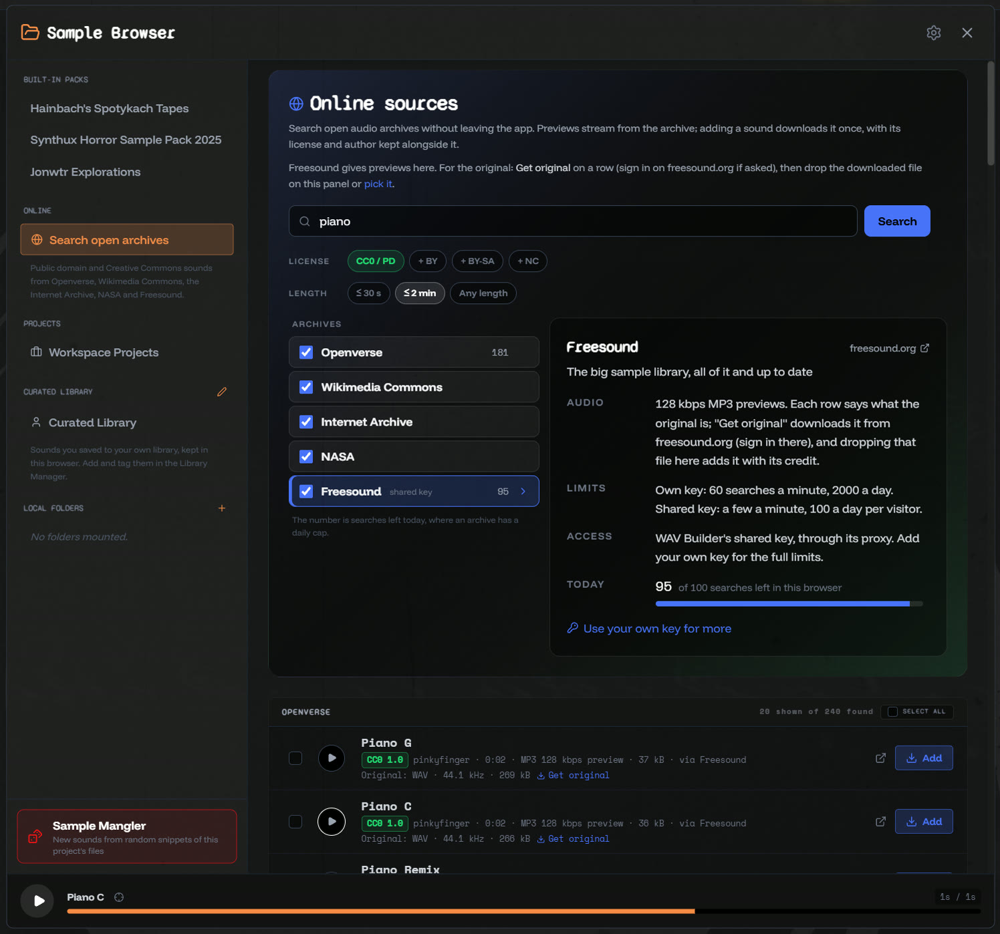

# Search open audio archives

The sample browser has a new source: **Search open archives**. It searches Openverse, Wikimedia Commons, the Internet Archive and NASA, and Freesound through a shared key, without leaving the app. It's under *Online* in Browse, in Studio's sample browser and in the Sample Mangler's picker.

- **Licence first.** Results are CC0 or public domain by default. Add BY, BY-SA or NC when you can credit the author or won't sell the result. Filter by length too.
- **Preview, then add** one sound or tick several. Each one keeps its author and licence.
- **Lossless where the archive has it:** the Internet Archive's FLAC or WAV over its MP3, Commons' original file.
- **Freesound** previews are MP3. *Get original* downloads the original from freesound.org (sign in there); drop that file on the panel and it's added with its credit.
- **Limits:** the shared Freesound key allows 100 searches a day per visitor. Add your own key for more.

[Full changelog](https://github.com/jonwaterschoot/spotykach_WAV_builder/blob/main/CHANGELOG.md)
