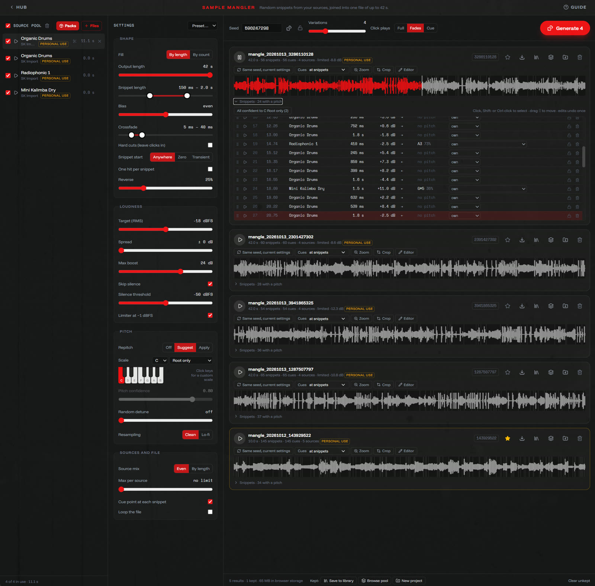
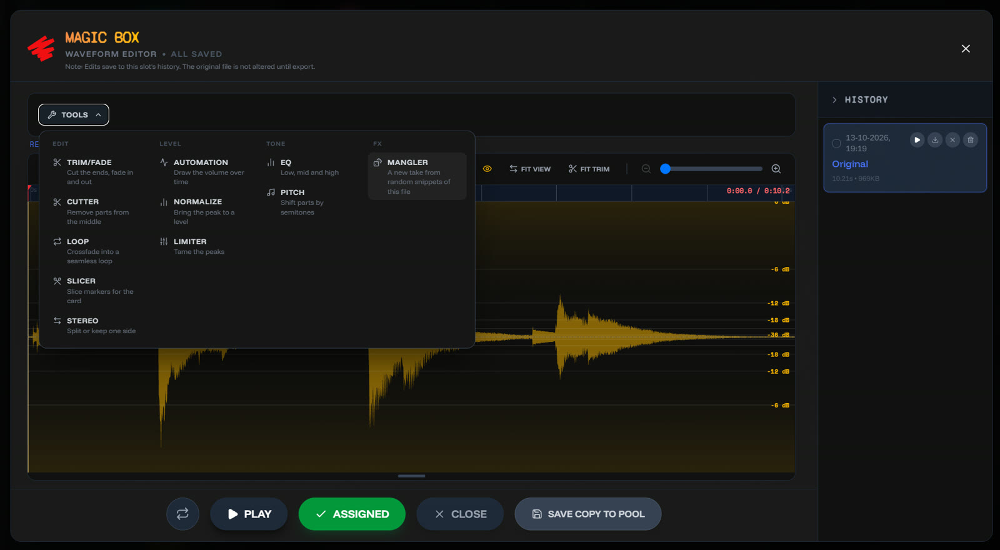
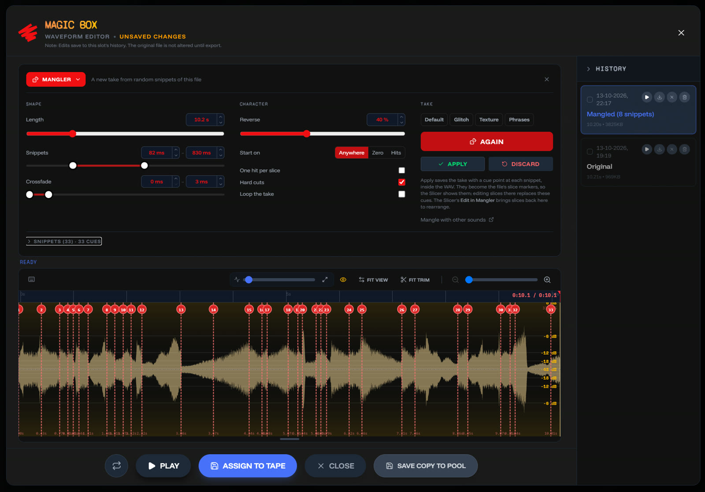

# Sample Mangler: a door for happy accidents

There's a new door on the hub, under *Tools & extras*. The **Sample Mangler** takes a pool of sounds, from the sample packs or your own files, cuts random snippets out of them and joins those into one file of up to 42 seconds. Every snippet starts on a cue point, so on the Spotykach the slice mode jumps from one fragment to the next.

It is meant to be unpredictable. Each snippet gets its own length, loudness, direction and maybe pitch, picked by dice inside ranges you set.

## How it goes

- **Fill the pool** from the packs, from files, or by dropping audio on the screen.
- **Set the ranges**: snippet length (20 ms to 10 s), crossfade (0 to 3 s), how often a snippet plays backwards, a loudness target with an optional spread, random detune. *Glitch*, *Texture* and *Phrases* are starting points.
- **Generate** a batch of up to 12 variations. Star the keepers; the rest go when the next batch starts.
- **Refine** a keeper snippet by snippet: play one, delete it, lock it and reroll the others, or move it to C. Each snippet's pitch is detected, and *Apply* moves every snippet with a clear pitch to the nearest C. *Same seed, current settings* renders a result again after you move a slider, so you hear only what that slider does.
- **Save** it as a WAV, to the Browse pool, to the Studio user library, or straight into a new Studio project.

Every result has a seed. Type it back in with the same settings and you get the same file.

## In the editor too

The waveform editor's new **Tools** menu has a Mangler under FX: a new take from random snippets of the file you have open, with a cue point at each snippet. *Apply* saves it as a new version in the slot's history; the original stays.

## Since launch

- **Hits and slices:** *Find hits* splits a source into single sounds, sorted into low, mid and high. Keep them in the slice pool, shape each one (shift, direction, gain, envelope), and turn a selection into a kit with a cue at each slice.
- **More dice:** the dice now roll settings, sources, slices, patterns and synth ranges too. Presets act as styles for the dice, and group locks keep the settings you like where they are.
- **A step sequencer** plays slices, cue points and a small synth. Linked to a Spotykach over MIDI, it sends or follows clock and Start / Stop, plays the decks with notes, and CC tracks move its controls step by step or with an LFO.

## Licences travel along

A mangled file is still made of the samples it came from. Packs that allow use in your own music but not passing the samples on mark the result *personal use*, and that note goes with the file wherever you save it. A pack that forbids changes altogether can be listened to in the mangler, but results using it can't be saved.

The mangler needs a desktop browser: decoding a large pool takes more memory than a phone tab has. Feedback is welcome on Discord (@jonwtr).
