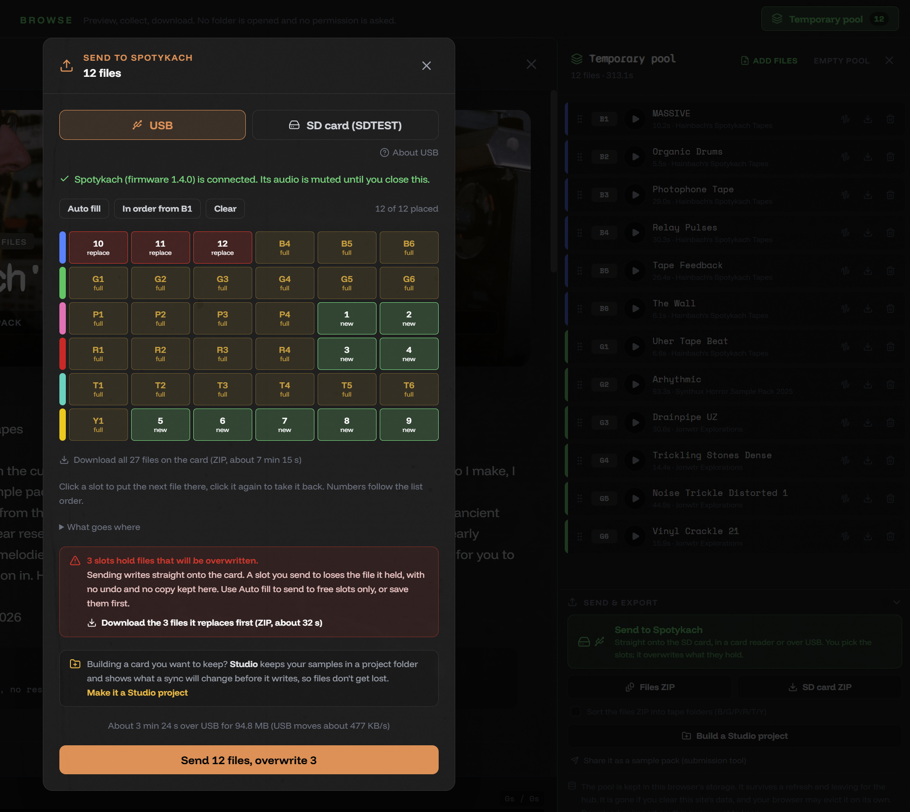

# Send to Spotykach, without a project

The quick tools reach the card now. **Browse Samples** and the **Editor** write straight onto your Spotykach, over USB or through a card reader, with no project and no folder to set up. The **Sample Mangler**'s card window works the same way.

- **Browse Samples:** *Send to Spotykach* is the main button under the temporary pool. Downloads and *Build a Studio project* are still there, smaller.
- **Editor:** open a slot from the Spotykach, edit it, and *Send* it back to the same slot, or to any other.
- **The whole card on one grid:** every slot shows as free or full. *Auto fill* uses the free slots. If your files don't all fit, you choose: overwrite full slots, or skip the rest. You can also click the slots yourself.
- **Overwriting is never silent.** Slots that will be replaced turn red, and you can download the files they hold as a ZIP first. *Download all files on the card* backs up the whole card the same way.
- **Over USB** you see how long it will take before you start, the time left while it runs, and a Stop button.

These windows keep no record of what you sent. For a card you want to keep building on, use **Studio**: it keeps your samples in a project folder and shows what a sync will change before it writes.

[Full changelog](https://github.com/jonwaterschoot/spotykach_WAV_builder/blob/main/CHANGELOG.md)
