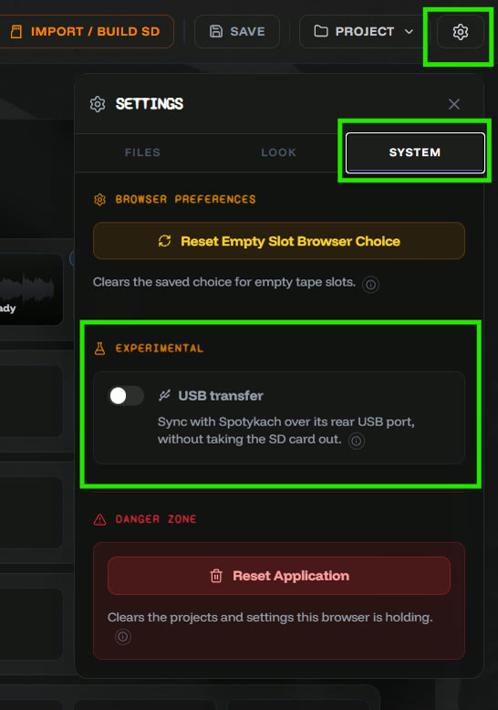
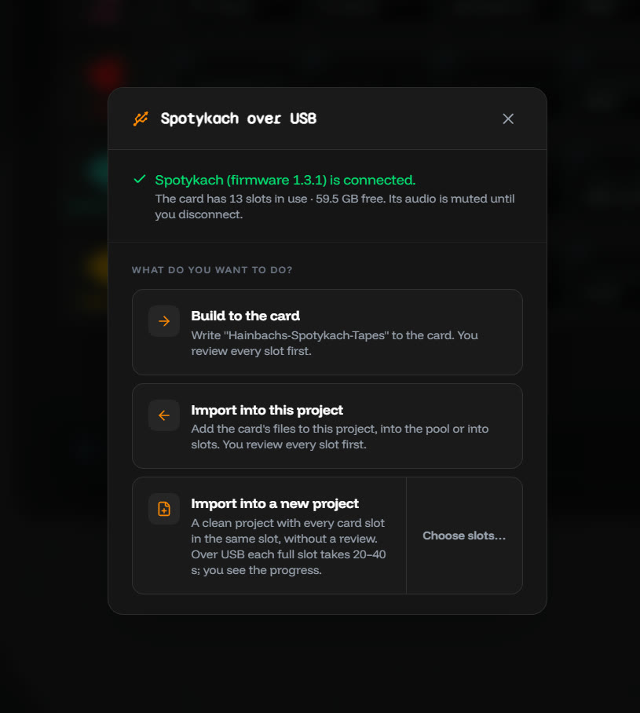
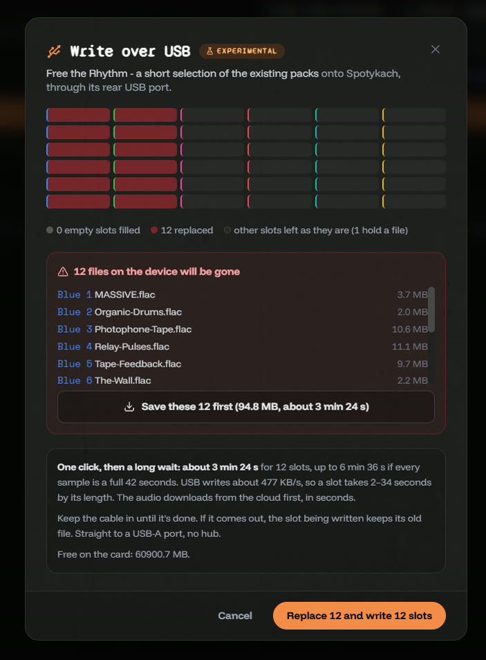

# USB transfer, in beta

WAV Builder can now reach the SD card while it stays in the Spotykach, through the rear USB port. It needs a beta firmware, and it's off until you switch it on.

**The card reader is still faster.** Over USB a full 42-second slot takes about 35 seconds, and a whole card of 36 slots about 10 minutes. For a full rebuild, take the card out. USB is for the smaller jobs: a few slots, a preset, a recording pulled off the device.

## Try it

1. Flash the beta firmware, **1.4.0 beta 1**, from Synthux's GitHub: [Spotykach v.1.4.0.b1](https://github.com/Synthux-Academy/Spotykach/releases/tag/v.1.4.0.b1).
2. In WAV Builder, open **Settings ▸ System** and switch on **USB transfer**. It needs Chrome or Edge on a computer.
3. Connect the Spotykach straight to a USB-A port on the computer, with a good data cable. Avoid hubs, even powered ones: in our tests, transfers through one stalled and dropped out.

## What it does

In **Studio**, switch the card to USB and choose: build the project to the card, import the card into the project, or start a new project from the card. You review every slot before anything is written.

In **Starter Presets**, *Write to SD card* has a third choice: *Over USB*. Before writing it shows which slots the preset fills and which files on the device it replaces, and it can save those to a ZIP first.

While it's in transfer mode the Spotykach is silent; it plays again when you disconnect. If the cable comes out halfway, the slot being written keeps its old file, and *Continue* picks up where it stopped.

It's a beta on both sides, firmware and app. Reports are welcome on Discord (@jonwtr) or as an issue on GitHub.

[Full changelog](https://github.com/jonwaterschoot/spotykach_WAV_builder/blob/main/CHANGELOG.md)
